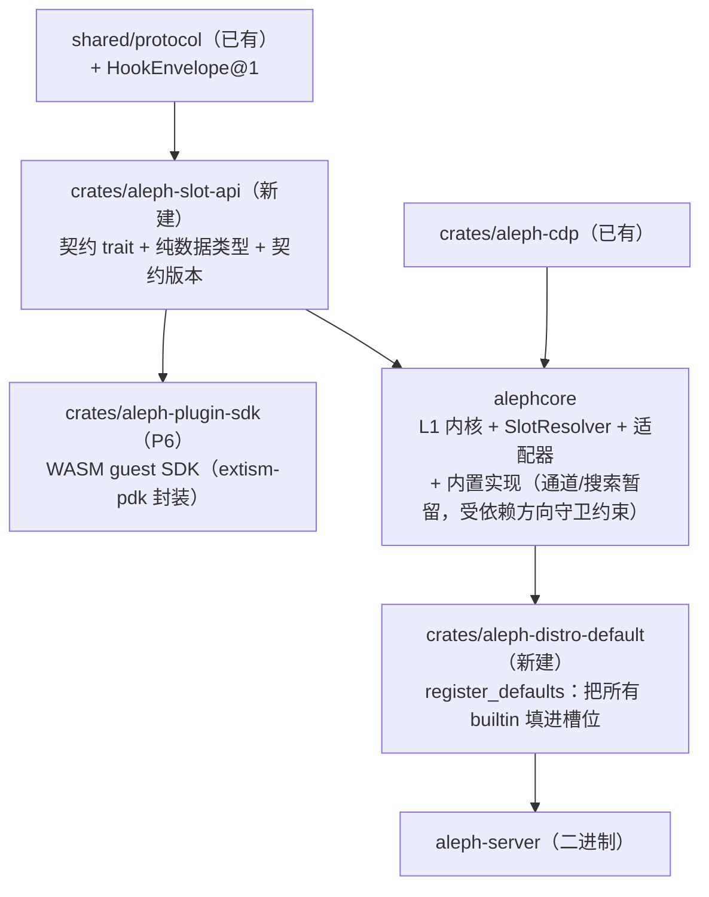

# Aleph 模块化重构方案：开箱即用 × 高度自定义

## 0. 任务目的

把 Aleph 重构成同时具备两种特质的 AI 助手：

1. 像 Codex 一样开箱即用：单一二进制，装好就有完整功能。Provider、工具、搜索、浏览器、记忆、通道、沙箱、技能都有可用的默认实现，用户不需要先选插件、写胶水代码，也不需要拼配置。
2. 像 pi 一样自由插拔：用户对任何一个模块或功能不满意，都可以用自己写的或社区的模块、插件替换掉，不用 fork、不用改内核、不用重新编译。替换走声明式配置，可以热生效、可以审计，也可以一键回退到内置实现。

在此基础上，Aleph 直接兼容 Claude Code 和 pi 的插件生态，让两边已有的插件尽量不改就能用，以此扩大 Aleph 的生态。

### 0.2 参考资料：oh-my-pi

[oh-my-pi](https://github.com/can1357/oh-my-pi)（omp）是 pi-mono 的一个分支，已经做到了「开箱即用 + 完全兼容 pi 生态」。它的策略值得参考：

**开箱即用方面**：
- 60+ 内置 provider、31 个内置工具、14 个 LSP 操作、28 个 DAP 操作，外加约 80k 行 Rust natives（剪贴板、shell/pty、文本搜索、AST 编辑、文件系统隔离、Git 操作、HTML/PDF 转 markdown、嵌入式 bash 带 58 个内置命令）。
- 单二进制分发（curl 安装脚本解压嵌入的 Bun + 平台 natives）和 npm 全局安装两条路径都支持。
- 首次运行时自动继承已有配置目录（`.claude`、`.cursor`、`.gemini`、`.codex` 等），无需迁移脚本。缺模型时引导用户 `/login <provider>` 或设置环境变量。

**生态兼容与自由替换**：
- 原生支持 pi 扩展、Claude Code 插件清单、Gemini manifest、MCP、技能、marketplace（npm/git/本地）。`package.json` 的 `omp.extensions` / `pi.extensions` 都能识别。
- 工具替换采用「同名覆盖 + 最后注册胜出」。扩展通过 `pi.registerTool()` 注册的工具直接覆盖同名内置工具，原内置保存在 `nativeToolsByName` 供包装工具调用 `ctx.invokeTool()` 委托。
- 记忆后端（`off` / `local` / `mnemopi` / `sharpshooter`，`memory.backend` 配置）、compaction 方法（`compaction.methodOrder` 数组 + `session_before_compact` hook）、provider（内置目录 + 用户 `models.yml` + 运行时发现 + 扩展注册）、LSP 服务器（`defaults.json` + 多层配置合并）都可替换。
- 配置分层清晰（内置默认 < 全局 < 项目 < CLI 覆盖 < 运行时覆盖 < 环境变量），`omp config list/get` 可以查看生效值和覆盖来源。

**对本方案的启发**：
- omp 的扩展在进程内拿完全权限（无沙箱），审批闸只在工具执行时生效，扩展改写输入后会重新走审批。这是 omp 的一个薄弱点。Aleph 方案里新增的能力授权轴和 WASM / MCP 进程边界可以避开这个问题。
- omp 的工具替换是静默的，用户看不出当前是内置还是扩展实现。Aleph 方案里 `served_by` 元数据和 `slots list` / `hooks list` 保证可观测。
- omp 用「最后注册胜出」解决冲突，Aleph 方案里同层冲突 fail-closed 并报告来源，更安全。
- omp 的记忆后端接口（`MemoryBackend`）、compaction hook、provider 注册这几处设计可以直接迁移。配置分层的文档化（`config get` 显示覆盖来源）也值得学习。
- omp 的原生绑定版本标记（后构建写入固定槽）避免每次版本更新重编译，这个做法 Aleph 的 native 后端可以借鉴。
- omp 的扩展加载、hook 事件、MCP 集成方式可以作为 pi-compat sidecar 的参考实现。

核心思路：内核只负责调度、状态和安全，所有可替换的能力都定义成「槽位（Slot）」。槽位分两类：

- 数据槽位：替换「由谁来做」，例如搜索引擎、嵌入模型、浏览器驱动、某个工具。
- 行为槽位：拦截「内核怎么做」，例如改写工具输入、追加 prompt 层、决定一轮结束后是否续跑。内核的实现不可替换，但它的关键决策点对插件开放拦截。

每个槽位有一份稳定的契约、一个内置默认实现，以及若干种可以用来替换的后端（Native / WASM / MCP / 插件包组件）。默认发行版把所有槽位都填上内置实现，所以开箱即用；用户配置只改动指定的槽位，不影响其他部分，所以可以自由替换。

### 0.1 Codex 与 pi 的取舍

| 维度 | Codex 的长处（吸收） | Codex 的短处（规避） | pi 的长处（吸收） | pi 的短处（规避） |
|---|---|---|---|---|
| 首次体验 | 装完即可用，默认值合理 | — | — | 核心刻意保持极简，很多能力要用户自己装扩展 |
| 功能完整度 | 内置沙箱、审批、工具一应俱全 | 内置实现难以替换，只能等官方迭代 | — | 默认能力薄 |
| 扩展性 | MCP / Skills 接入 | 扩展点有限，替换内置模块需 fork | 扩展是一等公民：改写 system prompt、拦截工具调用、续跑、自定义 compaction | 扩展可以整段改写 system prompt，安全约束也能被一起改掉 |
| 安全 | 默认沙箱 + 审批策略 | — | — | 扩展在进程内拥有完全权限，信任靠用户自担 |
| 分发 | 单二进制 | — | npm 包式安装和分享扩展 | 依赖 Node 运行时 |

Aleph 的组合方式：

- 默认像 Codex：单一 Rust 二进制，所有内置模块始终编译进去（遵守 DEVELOPMENT.md「所有生产功能始终编译，无需 feature flags」），默认沙箱和审批策略生效。
- 替换像 pi：每个可替换能力都是具名槽位；pi 扩展最常用的拦截点（`before_agent_start`、`tool_call`、`tool_result`、`turn_end`、compaction）在 Aleph 里都有对应的行为槽位。
- 安全比两者更严：第三方实现默认跑在隔离边界里（WASM 能力内核或独立进程），不进入宿主进程拿完全权限。prompt 只能按层替换，安全相关层固定；沙箱、审批、secrets 永不开放拦截。超出「增补」的权力需要逐项授权，授权与内容哈希绑定。

### 0.3 参考项目对比摘要

> 本表是 §0.1（Codex / pi 取舍）与 §0.2（oh-my-pi）的汇总版，供审阅者一屏看清「谁借鉴谁、借鉴到哪一层、什么明确不抄」。
> 事实来源全部落在仓库已有证据里，不引入未验证的对比结论。

| 参考项目 | 一句话定位 | 可借鉴点（吸收） | 不应照搬点（规避） | Aleph 落点 / 现状 |
|---|---|---|---|---|
| **Aleph（自身）** | 一核多端的 Rust Core + 多端 I/O；已有唯一 Tool 注册表与 capability 事实源 | ——（本列即基线） | —— | Tool capability 闭环**已完成**：`src/tools/registry.rs` 是唯一权威，`src/tool_metadata/registry/mod.rs` 降级为投影，`src/capability/{backend,facade,zahir_facade}.rs` 落地 describe / resolve / validate_lease / subscribe / project |
| **pi**（`@earqil-works/pi-coding-agent`） | 扩展是一等公民的极简 coding agent；TS 扩展在进程内跑 | 扩展 API 的**面**（`registerTool` / `registerCommand` / `sendMessage` / `events.on` / `on`）与事件命名；`session_shutdown` 是唯一 dispose 钩子的克制设计；配置文件 `package.json#pi {extensions, skills, prompts, themes}` 的声明式发现 | 进程内**完全权限**（无沙箱）；静默同名覆盖；允许整段替换 system prompt——等于把安全约束一起交出去 | 已决议「**Aleph 不托管 pi 扩展**」，方向是 pi → Aleph 走 MCP server / `aleph-cli`。证据：`docs/superpowers/specs/2026-09-20-plugin-scope-and-cc-compat-evidence/scan-pi.md`（2026-09-20 扫描 0.85.1）；本方案 §10.2 pi sidecar A/B/C 档 |
| **oh-my-pi**（omp，pi-mono 分支） | 单二进制 + 60+ provider / 31 工具 / LSP / DAP，开箱即用且兼容 pi 生态 | 配置分层可观测（`omp config list/get` 显示生效值**与覆盖来源**）；原生绑定版本固定槽（升级不必重编译）；记忆后端 / compaction / provider / LSP 皆可替换 | 同名覆盖「最后注册胜出」的静默冲突；扩展在进程内拿全部权限；工具替换对用户不可见 | 本方案 §5.2 双信任轴、§11 `served_by` + `slots list` / `hooks list` 负责可观测与冲突 fail-closed；§0.2 已有逐条对照 |
| **acpx / A2A** | acpx 是 ACP runtime，带 15+ agent 的 `AGENT_REGISTRY`；A2A 是 agent↔agent 协议 | 「协议即投影」的纪律：一份 wire type、一处审批推导；agent / 工具清单的**注册表形态**（注册表是唯一权威，其余是投影） | 把**外部进程的清单**当运行时权威（Aleph 的所有权在 `src/capability/ownership.rs::OwnershipTree`）；为兼容 TS runtime 引入 Node 依赖 | acpx 证据：`docs/superpowers/specs/2026-04-18-acp-harness-refactor.md` §1.3；Aleph 自有实现 `src/a2a/`（adapter / config / domain / port / service / sub_agent）与 `src/acp/`（client 方向）；本方案 §12 协议投影三条硬规则 |
| **pi-btw**（`@lanlance/pi-btw`） | 单文件 TS 扩展：把「顺带问一句」做成独立子会话 | 旁路提问的**形态**：独立子会话 + 工具白名单（`read` / `grep` / `find` / `ls`）+ 显式保留窗口（20 轮往返） | 整段复制主会话做上下文（Aleph 已改为**游标增量**：只追加上次关闭以来新增的部分） | Aleph 已有 `/btw`：`src/gateway/btw/`、`src/gateway/execution_engine/btw_wire_tests.rs`、`src/config/types/policies/mod.rs` 的 `btw_fork_turns`；对照见 `docs/superpowers/specs/2026-08-20-btw-side-questions-design.md` §2 |

English mirror: one screen of "who borrows from whom, at which layer, and what is explicitly not copied". Aleph's Tool capability closure is done (registry is the sole authority, catalog is a projection); pi contributes the extension-API *shape* but not its in-process full-permission model; oh-my-pi contributes observable config layering but not last-wins silent override; acpx/A2A contribute "protocols are projections" but not an external process's registry as runtime authority; pi-btw contributes the side-question shape but not whole-session copying (Aleph uses a cursor delta).

### 0.4 当前基线与本阶段边界（2026-10-22 复核）

> 本节把「文档里的方案」与「代码里的现状」对齐，避免把设计读成已实现。
> 同一基线的条目另见 `docs/reference/FEATURE_LOCATOR.md` §3.5d 的「三态基线」与 `docs/reference/PLUGIN_SYSTEM.md` 的 `Provider lifecycle foundation` 段落。
> English mirror: this section reconciles the design with the current tree — what is implemented (including provider call admission), what this phase only designs, what stays deferred, and the four things this phase explicitly does not do.

**三态 / Tri-state**

| 状态 | 范围 | 路径 | 验证标准（怎么验） | 旧代码清理点 |
|---|---|---|---|---|
| ✅ 已实现 | Tool capability 闭环：registry 唯一权威、catalog 降级为投影、facade 的 describe / resolve / validate_lease / subscribe / project 全落地 | `src/tools/registry.rs` · `src/tool_metadata/registry/mod.rs` · `src/capability/{backend,facade,zahir_facade}.rs` | `cargo test -p alephcore --lib`；facade / backend 定向测试 | 已完成回收：`CapabilityBackend::generation()` 与 `CapabilityDescriptor.owner_generation` 已删，generation 权威只在 `BackendLease.owner_generation` + `OwnershipTree::generation()` |
| ✅ 已实现 | provider lifecycle fencing：无副作用状态机 + generation + 旧 lease fail-closed（`ResolveError::StaleProvider`） | `src/capability/provider.rs` · `src/capability/facade.rs`（`BackendLease.provider_generation`）· `src/tools/registry.rs`（`new_with_provider` + callable 闸） | 定向测试：`provider_not_ready_hides_callable_snapshots_until_ready`（`src/tools/registry.rs`）· `provider_restart_invalidates_old_tool_leases_and_hides_projection`（`src/capability/zahir_facade.rs`）· `lifecycle_allocates_a_new_generation_on_each_start` / `invalid_transition_is_fail_closed` / `handle_shares_state_and_publishes_committed_transitions`（`src/capability/provider.rs`） | 本切片**没有引入第二 registry**，因此没有旧结构被取代、无删除项（判据「引入一个 Zahir 组件须同轮删掉被取代的旧结构」在本切片为空） |
| 🟡 本阶段（只做设计 + 入口，不接线） | **lazy activation**：provider 不在 boot 期启动，第一次被真正需要时才启动；入口 = `ProviderHandle` + `ToolHandlerRegistry::new_with_provider` 装配缝 + `ProviderHandle::subscribe_changes()` 通知面 | 设计落点：本节；契约面：`src/capability/provider.rs`（`transition(Starting)` 是唯一 generation 递增点） | 设计验收 = 能回答四个问题：谁触发启动（runtime owner，而不是读侧投影）· 启动失败落到 `Failed` 还是 `Stopped`（`Failed`）· 并发启动是否单飞（`transition` 对非法迁移返回 `ProviderLifecycleError::InvalidTransition`，需 owner 侧串行）· 未 `Ready` 期间 `describe/resolve` 返回什么（非 Ready 时 callable projection / `describe` 隐藏能力；`resolve` 不应签发可调用 lease——若 resolve 过程中发生 restart / 状态竞态，直接返回 `StaleProvider`；`validate_lease` 是对已有 lease 的再次 fail-closed 校验） | 下次引入 lazy activation 时**不得**新增第二份 enabled/disabled 判定：`src/extension/plugin_state.rs` 的 durable enabled 状态 + `src/extension/lifecycle.rs::ExtensionManager` 是唯一权威；若出现第二份判定，必须同轮删除 |
| ✅ 已实现 | provider call admission（已提交）：每代 handler 包装 + 调用点准入（`ProviderLifecycle::acquire_call` / `ProviderHandle::acquire_call` / `ProviderCallError` / `ProviderLifecycleError::GenerationExhausted`） | `src/capability/provider.rs`（`acquire_call` 同判 state 与 generation；`transition(Starting)` 的 generation 递增改为 `checked_add`，溢出即 `GenerationExhausted` fail-closed）· `src/tools/registry.rs`（`ProviderCallHandler` 包装 resolve / snapshot / unregister 取到的 handler，准入失败映射为 `ToolError::PermissionDenied`）· `src/capability/zahir_facade.rs`（`resolve` / `validate_lease` 在签发与复验 lease 时做 `acquire_call`，失败即 `StaleProvider`） | 定向测试：`call_admission_requires_ready_and_the_current_generation` / `exhausted_generation_cannot_restart_or_readmit_old_calls`（`src/capability/provider.rs`，已随本阶段提交）· 实跑 `cargo test -p alephcore --lib capability::provider::` → 5 passed / 0 failed | 未引入新 registry；旧 lease 失效语义沿用 `StaleProvider` |
| ⛔ Deferred | Gateway / Terminal / Memory 接入统一 backend；sidecar supervisor；Rust dylib 热卸载；EffectClaim producer；automatic Safe Replay；其余 kind backend | `src/gateway/**` · `src/gateway/pty/manager.rs::PtyManager` · `src/memory/extensions/registry.rs::MemoryExtensionRegistry` · `src/gateway/channel_registry.rs::ChannelRegistry` · `src/extension/lifecycle.rs::ExtensionManager` | 未实现 ⇒ 任何文档、汇报、README 不得写「已接入统一 backend」 | —— |

**仍是独立边界的四件事（不要合并叙述）/ Still separate boundaries（do not merge in prose）**：

- `src/extension/lifecycle.rs::ExtensionManager` —— 插件发现 / mount / unmount / reload 的权威，与 provider lifecycle **并排**而非上下级。
- `src/gateway/channel_registry.rs::ChannelRegistry` —— 通道工厂注册表，重复注册直接报错。
- `src/gateway/pty/manager.rs::PtyManager` —— 终端进程管理，与 capability backend 无关。
- `src/memory/extensions/registry.rs::MemoryExtensionRegistry` —— 记忆扩展注册表（被 `src/agents/**` 与 `src/a2a/sub_agent.rs` 使用）。

**明确不做（本阶段边界）/ Explicit non-goals**：

1. **不做 Rust dylib 热卸载** —— native Rust 动态库的卸载语义（析构顺序、静态状态、后台线程）不在本契约内；native backend 的换装走「进程边界 + 重启」，不是「热卸载」。
2. **不做 sidecar supervisor** —— `ProviderTransport::Bridge` 只是契约里的一个 transport 标记；进程监督、握手、健康检查、重启策略属于将来的 supervisor 组件，本阶段没有这个组件。
3. **不引入第二 registry** —— 工具的唯一权威仍是 `src/tools/registry.rs::ToolHandlerRegistry`；provider lifecycle 不新建任何注册表。
4. **不让 catalog / diagnostic / MCP projection 隐式启动 disabled provider** —— `src/tool_metadata/registry/mod.rs`（catalog）、`src/capability/diagnostic_control.rs`、`src/tools/handlers/mcp.rs` 都是**只读**投影：读 provider 状态不得产生 `Starting` 转换；disabled 的判定只认 `src/extension/plugin_state.rs` 的 durable enabled 状态。

**接线实况（避免把设计读成已接线）/ Current wiring reality**：

- 全仓 `ProviderState::Starting` / `transition(ProviderState::…)` 的调用点**只有测试**（`src/capability/zahir_facade.rs`、`src/tools/registry.rs` 的 test 模块），生产路径没有一处驱动 transition。
- 生产只调用 `ToolHandlerRegistry::new()`（`src/tools/registry.rs::ToolHandlerRegistry::new`），它造的是 `ProviderLifecycle::ready(...)`（`Ready`、generation 1）；`new_with_provider` **没有生产调用点**。
- 结论：fail-closed 闸门今天在生产里是 dormant 的——默认路径永远 `Ready`，既不会隐式启动，也不会被停止。这既是事实，也是 lazy activation 要接手的位置。
- 已提交的 call admission 切片：`acquire_call` 准入 + 每代 handler 包装把「状态 + generation」的比对从 lease 校验延伸到调用点，但仍**不驱动任何 transition**——「谁来启动 provider」这一环依旧空着，那正是 lazy activation 的位置。生产路径的 handler 已由 `ProviderCallHandler` 包装（`resolve_entry` / `unregister` / `snapshot_state`），但生产 provider 恒为 `Ready` / generation 1 ⇒ 今天的准入不会拒绝任何调用。

---

## 1. 架构基线（现有资产）

本方案以现有代码为基础，不另造平行体系。

| 资产 | 位置 | 在本方案中的角色 |
|---|---|---|
| `ToolHandler` trait | `src/tools/handlers/mod.rs:27` | 工具槽位契约（`invoke` / `definition` / `concurrency_claim` / `fences_output`） |
| `ToolHandlerRegistry` | `src/tools/registry.rs:304` | 工具唯一权威注册表：`register` / `replace` / `unregister` / `snapshot_state` / `subscribe` / `close`，带 revision；其通用部分抽成 `VersionedRegistry<T>`（§6.5） |
| `ToolCatalog` | `src/tool_metadata/registry/mod.rs:62` | 工具元数据，降级为 Registry 的投影 |
| `CapabilitySlot<T>` | `src/capability/mod.rs:111` | 进程级可热换单元（`SearchHandle`、cron、heartbeat、PII、metrics 已在使用） |
| `CapabilityKind`（9 类） | `src/capability/descriptor.rs:24` | 槽位类别：Tool / Skill / Agent / Task / Resource / EventSource / Subscription / Plugin / Hook |
| `OwnershipTree` / `ZahirFacade` | `src/capability/{ownership,zahir_facade}.rs` | 槽位所有权、代际与租约的事实源 |
| `AiProvider` trait | `src/providers/mod.rs:250` | LLM Provider 槽位契约 |
| `SearchProvider` + `SearchHandle` | `src/search/{provider,handle}.rs` | 搜索槽位契约 + 热换句柄（重建失败时保留旧代） |
| `Channel` / `ChannelFactory` | `src/gateway/channel.rs:827,1126` | 通道槽位契约 |
| `ChannelRegistry` + 工厂注册表 | `src/gateway/{channel_registry.rs,interfaces/plugin.rs}` | 通道工厂注册，重复注册直接报错 |
| `EmbeddingProvider` | `src/memory/embedding_provider.rs:13` | 记忆子系统中可替换的向量化槽位 |
| `PromptLayer` trait + 各层 | `src/thinker/prompt_layer.rs:327`、`src/thinker/layers/` | prompt 分层替换的单元；守卫在 `src/thinker/prompt_contract.rs` |
| Hook 体系 | `src/extension/types/hooks.rs`（`HookEvent` / `HookKind` / `HookPriority` / `HookAction`）、`src/extension/hooks/executor.rs` | 行为槽位的执行引擎；Interceptor 串行可短路，Observer 并行只记录 |
| 工具调用前的 hook 闸 | `src/tools/scoped/dispatch.rs:486-527` | hook 改写输入后重新走 deny / operator / confirmation 闸 |
| 每请求工具服务构造 | `src/gateway/execution_engine/tool_service_builder.rs:155` | 每次运行取 hook 快照的接入点 |
| 插件信任 | `src/extension/plugin_trust.rs:51`（`OwnerTrustPolicy`）、`src/extension/plugin_state.rs` | 加载信任轴；能力授权轴在此基础上新增（§5.2） |
| WASM 运行时 | `src/extension/runtime/wasm/`（extism 1.7） | 进程内隔离后端：`capability_kernel` / `allowlist` / `limits` / `credential_injector` / `host_functions` |
| MCP 客户端 + `McpToolHandler` | `src/mcp/`、`src/tools/handlers/mcp.rs` | 进程外隔离后端 |
| 插件清单适配器 | `src/extension/manifest/adapters/{aleph_toml,codex,cursor,auto_discover}.rs`、`cc_plugin_json.rs` / `cc_plugin_toml.rs` | 兼容 Aleph / Codex / Cursor / Claude Code 插件格式；pi 适配器在此新增 |
| Claude Code hook 输出兼容 | `src/extension/hooks/json_output.rs` | 解析 `hookSpecificOutput`，保证 Claude Code 的 Command hook 原样可用 |
| 插件市场 | `src/extension/marketplace/{github_source,local_source,installer}.rs` | 社区模块的发现与安装；npm 源在此新增 |
| 运行时下载 | `src/runtimes/` | 按需准备 Node / Bun 等外部运行时 |
| 已独立的 crate | `shared/protocol`、`shared/logging`、`shared/client`、`crates/aleph-cdp` | 依赖 DAG 的底层 |

> 历史说明 / Historical note：`crates/agent-detect` 已移除，不属于当前 crate inventory。其移除前代码保存在仓库根目录 `archive/removed-terminal-agent-moa/` 中。

---

## 2. 三层模型

```text
┌──────────────────────────────────────────────────────────────┐
│ L3 替换面（用户 / 社区）                                        │
│   ~/.aleph/config.toml [slots.*]  ·  插件包  ·  市场            │
│   后端：native crate | wasm | mcp | command | plugin component │
├──────────────────────────────────────────────────────────────┤
│ L2 默认模块（内置，始终编译，开箱即用）                           │
│   providers · tools · search · browser(aleph-cdp) · channels  │
│   memory 检索/嵌入 · skills · agents · hooks · prompt 可替换层   │
├──────────────────────────────────────────────────────────────┤
│ L1 内核（实现不可替换；关键决策点开放拦截；只配置策略）            │
│   harness 循环 · session SSOT · gateway 控制平面 · config       │
│   capability 所有权/租约 · 沙箱与审批 · secrets vault · 审计     │
│   prompt 固定层                                                │
└──────────────────────────────────────────────────────────────┘
```

划分原则：

- L1 内核：负责状态权威、安全边界和调度循环。替换它们等于替换产品本身，也会破坏 R10 薄 Harness、Session SSOT 和安全模型，所以实现不可替换。内核的几个关键决策点（compaction、prompt 装配、工具调用前后、一轮结束）以行为槽位的形式开放拦截（§3.2）。沙箱、审批、secrets 不开放拦截，只开放策略参数（沙箱档位、审批模式）。
- L2 默认模块：每个模块都要满足两点：通过契约接入，并且是某个槽位的 `builtin` 实现。内核代码不直接引用具体实现类型，只依赖契约。
- L3 替换面：用户的意图只能用声明式配置或插件清单表达。替换在运行时完成，不需要重新编译 Aleph。

记忆的处理方式：记忆的编排（prompt 装配、上下文仲裁、会话快照、整理/自省）跟 session 和 harness 深度交织，留在 L1。暴露给替换面的是它的叶子能力：`memory.embedding`（`EmbeddingProvider`）、`memory.recall`（记忆检索工具）、`memory.ingest_filter`（写入前钩子）。用户可以换向量模型、换检索策略，甚至把检索接到外部知识库，但不能绕开内核的记忆权威。

---

## 3. 槽位目录

每个槽位有固定 ID、契约版本、内置默认实现，以及允许用来替换的后端。

### 3.1 数据槽位

| 槽位 ID | 契约 | 内置默认 | 可选后端 | 基数 | 热换 |
|---|---|---|---|---|---|
| `provider.<name>` | `AiProvider@1` | `HttpProvider` + 装饰器栈 | native, mcp(sampling 代理) | 多 | 是（route handle） |
| `tool.<name>` | `ToolHandler@1` | `BuiltinHandler` | native, wasm, mcp, plugin | 多 | 是（Registry `replace`） |
| `search.provider` | `SearchProvider@1` | Tavily / Brave / Exa / DuckDuckGo 等 | native, wasm, mcp | 多（合并排序） | 是（`SearchHandle`） |
| `browser.driver` | `BrowserManager@1` | `aleph-cdp` | native, mcp（如 Playwright MCP） | 单 | 重启 |
| `channel.<type>` | `ChannelFactory@1` | `gateway/interfaces/*` 下的内置通道 | native, process(stdio 桥接) | 多 | 实例级重建 |
| `memory.embedding` | `EmbeddingProvider@1` | 内置嵌入 | native, mcp, http | 单 | 重启（向量维度变更需重建索引） |
| `memory.recall` | `ToolHandler@1` | 内置记忆检索工具 | wasm, mcp | 单 | 是 |
| `skill.<name>` | Skill 清单 | 内置技能 | plugin | 多 | 是 |
| `agent.<name>` | Agent 清单 | 内置 Agent | plugin | 多 | 是 |
| `prompt.<layer>` | `PromptLayer@1`（仅可替换层，§7） | 内置层 | plugin | 单 | 是（下一轮生效） |

### 3.2 行为槽位

行为槽位都是「链」基数，契约统一为 `Hook@1`（§6）。

| 槽位 ID | 拦截点 | 能做什么 | 对应 pi 事件 / Claude Code 事件 |
|---|---|---|---|
| `tool.pre` | 工具调用前 | 改写输入、阻断、请求确认；改写后一律重新过闸 | `tool_call` / `PreToolUse` |
| `tool.post` | 工具结果返回模型前 | 追加或改写结果、标注 | `tool_result` / `PostToolUse` |
| `prompt.assembly` | 每轮 prompt 装配 | 追加插件层；只能替换可替换层（§7） | `before_agent_start` / `UserPromptSubmit` |
| `context.compaction` | 上下文压缩 | 提供自定义摘要；内核校验结构后才采用 | compaction 相关事件 / `PreCompact` |
| `turn.continue` | 一轮结束、准备停下时 | 要求再跑一轮并附带理由 | `turn_end` / `agent_before_settle` / `Stop` |
| `memory.ingest_filter` | 记忆写入前 | 过滤、脱敏、改写待写入内容 | — |
| `session.lifecycle` | 会话开始 / 结束 | 只观察，不改变流程 | `session_start` / `session_shutdown` / `SessionStart` / `SessionEnd` |

行为槽位的边界：

- `turn.continue` 带上限，由内核计数，默认每个用户回合最多续跑 3 次（`[hooks] max_continuations`，可配置）。到上限后内核停下并把原因告知模型和用户。插件无法自己重置计数。
- `context.compaction` 的产物必须通过内核的结构校验（保留必需的会话标记、工具调用配对完整），不通过就丢弃并使用内置 compaction，同时记一条审计事件。
- 沙箱判定、审批决策、secrets 解析没有对应的行为槽位，任何 hook 都无法拦截或改写。

基数语义：

- 单：同一时刻只有一个实现。替换会把内置实现挤下去。
- 多：按名字区分，多个实现并存。同名时按替换规则处理。
- 链：按优先级组合，支持 `prepend` / `append` / `disable`。

不在目录里的东西（harness、session、gateway 主体、沙箱、secrets、审批）都属于 L1，不开放替换。

---
## 4. 替换机制

### 4.1 用户配置

```toml
# ~/.aleph/config.toml

# 用社区 MCP 搜索服务替换内置搜索
[slots."search.provider"]
use = "mcp:my-search"
mode = "replace"          # replace | prepend | append | disable
# fallback 不写时按 §4.4 的默认语义处理

# 用 WASM 插件替换内置的 web_fetch 工具
[slots."tool.web_fetch"]
use = "wasm:~/.aleph/plugins/fetch-plus/fetch_plus.wasm"
capabilities = ["http_fetch"]
allow_hosts = ["*.example.com"]

# 关掉一个不需要的内置工具
[slots."tool.notebook_edit"]
mode = "disable"

# 浏览器换成 Playwright MCP
[slots."browser.driver"]
use = "mcp:playwright"

# 某个插件包里的组件接管一个槽位
[slots."memory.recall"]
use = "plugin:acme-memory/recall"

# 替换一个可替换的 prompt 层
[slots."prompt.soul"]
use = "plugin:my-persona/soul"
```

`use` 的取值形如 `<backend>:<locator>`：

- `builtin[:<name>]`：内置实现，默认值。
- `native:<crate>::<factory>`：编译进自定义发行版的 Rust 实现，见 §9.3。
- `wasm:<path|plugin-id>`：extism 沙箱里的模块。
- `mcp:<server-id>`：`[mcp.servers]` 下声明的 MCP 服务。
- `plugin:<plugin-id>/<component>`：已安装插件包在清单里声明的组件。

行为槽位的 hook 不经过 `use`，而是由用户 hook 配置（`~/.aleph/hooks.json`）和插件清单登记，按 §6.3 的分段规则排序。

### 4.2 解析顺序

单个槽位的最终实现按以下优先级确定，前面的覆盖后面的：

1. 会话级覆盖（运行时调用 `slots.set`，只对当前会话生效）
2. 项目级 `.aleph/config.toml`
3. 用户级 `~/.aleph/config.toml`
4. 插件包清单里 `claims` 声明的槽位（需要对应的能力授权，§5.2）
5. `builtin`

同一层里出现两个声明认领同一个单基数槽位，直接 fail-closed：槽位进入 `Conflicted` 状态，`aleph slots doctor` 列出冲突来源，不会静默选一个。这和 `interfaces/plugin.rs` 遇到重复工厂注册就报错的做法一致。

### 4.3 生效与热换

- 解析在一处完成：新增 `SlotResolver`，它的输入是 config 快照、插件清单和授权记录，输出 `SlotPlan`（纯值，可以序列化、可以 diff）。
- 应用复用现有机制，不另造一套：
  - 工具类槽位：`ToolHandlerRegistry::replace` / `register` / `unregister`，靠 revision 推进和 `subscribe` 广播。
  - 行为槽位：`HookRegistry`（§6.5）的同名操作。
  - 进程级槽位：`CapabilitySlot<T>` 的安装/替换。搜索直接沿用 `SearchHandle::apply_config` 的语义，重建失败时保留旧代，并把结果如实降级为 `Restart`。
  - 所有权：每次应用都在 `OwnershipTree` 里登记新的 owner generation。旧租约通过 `validate_lease` 失效，进行中的调用在旧代上跑完。
- 配置写入走现有的 `config::live_apply`，新增一个 `slots` 分支。热换失败的槽位保持旧实现，并上报 verdict。

### 4.4 回退与失败语义

失败分成两种，默认行为不同：

| 失败类型 | 例子 | 默认行为 | 可见性 |
|---|---|---|---|
| 解析期 | 插件没装、内容哈希变了、授权失效、WASM 校验失败、MCP 握手失败、sidecar 起不来、契约版本不兼容 | 回退到 `builtin` | `served_by` 显示 `builtin`，注明原因；`slots doctor` 标红；启动日志和首次会话各通知一次 |
| 调用期 | 替换实现已在服务，某次调用超时或报错 | 不回退，错误原样返回给模型，由模型自己处理（12-Factor A2；harness 不替模型挑恢复策略，R10 第 5 不） | 错误里带 `served_by`，模型和用户都能看到是哪个后端失败；提示里直接给出 `aleph slots reset <slot>` |

例外与显式配置：

- `memory.embedding` 在任何阶段都不回退。向量维度和语义空间不同，混用会污染索引。解析期失败时，召回功能整体降级为不可用，并提示重建索引。
- 用户显式写 `fallback = "none"`：解析期也不回退，槽位进入 `Failed`，对应功能不可用。适合「宁可坏也不要内置」的用户。
- 用户显式写 `fallback = "builtin"`：调用期也回退，但每次回退都在结果元数据里标出 `served_by = builtin(fallback)`，并记一条审计事件。不允许静默回退（判据 11）。

守卫测试要断言效果到达（判据 4）：解析失败后确实由 builtin 在服务，且 `served_by` 如实反映，不能只断言回退函数被调用。

### 4.5 契约版本

- 每个契约都带主版本号，例如 `ToolHandler@1`、`SearchProvider@1`、`Hook@1`、`PromptLayer@1`。
- 插件清单声明自己实现的版本，`SlotResolver` 只接受主版本相同的实现，不一致就按解析期失败处理。
- 契约有破坏性变更时升主版本，旧版本适配器至少保留一个 CalVer 发布周期。
- 跨语言的 wire 契约只有一份：`HookEnvelope@1`（§6.2），放在 `shared/protocol`。

---

## 5. 后端与信任模型

### 5.1 后端

| 后端 | 隔离方式 | 适合场景 | 默认权限 |
|---|---|---|---|
| `builtin` | 宿主进程 | 默认实现 | 内核授予 |
| `native` | 宿主进程（自定义发行版编译时链接） | 对性能敏感、需要深度集成的企业定制 | 等同内置；只能通过自定义发行版引入，见 §9.3 |
| `wasm` | extism 沙箱 + `WasmCapabilityKernel` | 纯计算、轻 IO 的工具、过滤器、检索策略、hook | 零能力；`capabilities` / `allow_hosts` 逐项授权；`limits` 限制内存和时长；secrets 只通过 `credential_injector` 按名注入，不暴露明文 |
| `mcp` | 独立进程 + 协议边界 | 任意语言实现的工具、搜索、浏览器、知识库、常驻 hook 服务 | 进程权限受沙箱档位约束；输出一律 `fences_output = true` 当不可信数据处理 |
| `command` | 一次性子进程 | Claude Code 风格的脚本 hook（shell / node / bun / python） | 受沙箱档位约束；stdin 传 JSON，stdout 回 JSON |
| `plugin` | 由组件的实际后端决定（wasm / mcp / command / 纯声明式的 skill / agent / prompt） | 一次安装一组相关能力 | 取组件后端的权限，再与两个信任轴（§5.2）取交集 |

规则：

1. 第三方代码不能以 `native` 形式在运行时加载。不支持 `dlopen` 动态库插件，因为 Rust 没有稳定 ABI，而且会把 extism 和进程边界建好的隔离整个绕过去。
2. 不在 Aleph 进程里嵌入 JS 引擎（V8 / deno_core）。它违反 R3，而且进程内没有隔离边界。JS/TS 插件走 command、MCP、WASM（Extism JS PDK）或 pi-compat sidecar（§10.2）。
3. 被替换的工具保留原有的准入、并发声明（`concurrency_claim`）和审批策略。替换实现不能借替换的机会把自己的权限声明得比原槽位更宽，除非单独授权。

### 5.2 两个信任轴

| 轴 | 回答的问题 | 默认值 | 存放位置 |
|---|---|---|---|
| 加载信任（现有，`OwnerTrustPolicy`） | 这段代码能不能跑 | `[trust] enforce = false`。`Bundled` / `Config` 来源恒信任；开启强制后 `Workspace` / `Global` / `ClaudeCache` 来源要进白名单 | `plugins.toml` 的 `[trust]` 段与条目的 `trusted` 字段 |
| 能力授权（新增） | 它能拿到哪些超出「增补」的权力 | 始终默认拒绝，不受 `enforce` 影响 | `plugins.toml` 条目新增 `grants`，与插件内容哈希绑定 |

加载信任保持默认关闭，理由是升级后如果默认开启，会悄悄停用用户已装的插件，而第一件事就弄坏现有安装的安全控制，最后只会被用户关掉。安全的重心放在能力授权轴上。

需要能力授权的操作（逐插件、逐项）：

- 认领单基数槽位，或替换内置实现
- 替换 prompt 可替换层（§7）
- hook 优先级提升到 `High`（§6.3）
- WASM 的 `capabilities` / `allow_hosts`
- sidecar 和 command 后端的文件、网络权限超出沙箱默认档

不需要授权的操作（保证开箱即用和 Claude Code 兼容）：

- 新增工具、技能、命令、MCP server
- `Normal` / `Low` 段的 Observer 与 Interceptor hook。改写后的输入一定重新过闸（§6.4），所以这类 hook 无法借改写绕过审批

授权方式：

- 交互确认，或 `aleph plugin grant <id> <item>`；撤销用 `aleph plugin revoke <id> <item>`。
- 插件更新后内容哈希变化，高权限授权失效，需要重新授权；纯增补能力不受影响。
- 无人值守、没有审批通道时一律不授权，槽位保持 builtin，并在 `slots doctor` 标红。这和「hook 请求确认但没有审批通道就自动拒绝」（`RefusedBy::NobodyAsked`）的做法一致。
- 无头部署（服务器、CI）需要提前在配置里写好 `grants`。
- 每次授权、撤销、授权失效都写入审计日志，内容包括槽位、来源、哈希和授予的能力。

---

## 6. Hook 体系

### 6.1 Rust 契约

```rust
/// Contract for every behavior-slot participant, regardless of backend.
/// Adapters (Command / Prompt / Agent / Http / Wasm / Mcp / PiSidecar)
/// translate their wire format into this trait; the executor only sees this.
#[async_trait]
pub trait Hook: Send + Sync {
    /// Static facts used for ordering and authorization; never changes per call.
    fn descriptor(&self) -> &HookDescriptor;

    /// Run against one event. Interceptors may rewrite or block;
    /// observers' results are recorded but never change the flow.
    async fn execute(&self, event: &HookEvent, ctx: &HookContext)
        -> Result<HookResult, HookError>;
}
```

- 适配器：`Command`、`Prompt`、`Agent`、`Http`、`Wasm`、`Mcp`，以及 P6 新增的 `PiSidecar`。现有 `HookAction`（`src/extension/types/hooks.rs:448`）的各变体逐一改写成适配器，`HookAction::Plugin` 拆到 `Wasm` / `Mcp`。
- `HookKind` 语义不变：`Interceptor` 串行、可短路；`Observer` 并行、只记录。
- `HookError` 的处理：Interceptor 出错时 fail-closed（视为阻断并把原因返回给模型）；Observer 出错只记录。

### 6.2 跨语言 wire 契约：`HookEnvelope@1`

- 放在 `shared/protocol`，是 Command / Http / Mcp / WASM / sidecar 共用的唯一 JSON 形状（判据 10：跨 crate 的 wire 契约只有一份）。
- 内容：`version`、`event`、`session_id`、`turn_id`、`slot`、`payload`（事件相关）、`original_input`（被改写前的输入，供审计和后续 hook 参考）。
- 返回：`decision`（`continue` / `block` / `ask`）、`updated_input`、`additional_context`、`reason`。
- 对 Claude Code 的 `hookSpecificOutput` 保持兼容：`src/extension/hooks/json_output.rs` 把它翻译成同一个返回形状，Claude Code 的 Command hook 原样可用。

### 6.3 优先级分段

优先级按「来源 × 信任」分段，插件不能自己声明进更高的段：

| 段 | 谁能进 | 说明 |
|---|---|---|
| `System` | 仅内核编译进来的 hook | 插件和用户配置都进不来 |
| `High` | 用户配置；已授权的插件 | 插件需要能力授权（§5.2） |
| `Normal` / `Low` | 用户配置；任何插件 | 默认段 |

- 段内排序键：`(段, 来源层, priority, plugin_id)`，结果确定、可复现。
- 插件声明的优先级超出允许的段时降到允许的最高段。降级在 `aleph hooks list` 和启动日志里可见，不静默处理。
- 现有代码 `src/extension/mod.rs:1075` 把数值 `<= System` 的插件优先级直接映射成 `System`，允许插件自封 System。这一处在 P0.5 改掉，并加守卫测试。

### 6.4 改写后重新过闸

`src/tools/scoped/dispatch.rs:486-527` 现在的行为是：hook 改写输入后，如果 `effective_input != input`，重新跑 deny / operator / confirmation 三道闸。本方案把它写成契约，并加守卫测试，断言「被改写的输入确实经过了闸」，而不是只断言 hook 被调用（判据 4）。

- `updated_input` 在 Interceptor 链上逐个传递（`src/extension/hooks/executor.rs:1317-1321` 现有行为），最终输入只过一次闸。
- hook 返回 `ask` 而当前会话没有审批通道时，自动拒绝（`RefusedBy::NobodyAsked`）。
- 审计记录同时保存 `original_input` 和最终输入。

### 6.5 注册与快照：`VersionedRegistry<T>`

- 从 `ToolHandlerRegistry` 抽出泛型 `VersionedRegistry<T>`，放在 `src/capability/`，提供 `register` / `replace` / `unregister` / `snapshot` / `revision` / `subscribe` / `close`。
- `ToolHandlerRegistry` 和新的 `HookRegistry` 是它的强类型外壳。两者共用一套版本化语义，但互相独立，不混在同一张表里。
- Hook 投影进 `OwnershipTree`，使用 `CapabilityKind::Hook`（这一类别现在没有生产使用）。
- `HookExecutor`（`src/extension/hooks/executor.rs:456`，现在持有 `hooks: Vec<HookConfig>`）改成每次运行的快照消费者：`build_request_tool_service`（`src/gateway/execution_engine/tool_service_builder.rs:155`）构造 `ScopedToolService` 时取一次 `HookRegistry` 快照，整次运行用同一代。
- 插件 hook（`PluginRegistry::register_hook`，`src/extension/registry/plugin_registry/mod.rs:237`）和用户 hook（`~/.aleph/hooks.json`，`hooks/user_settings.rs`）都改为写入 `HookRegistry`。
- 现状已经具备「整体替换」语义，重构要保住它：`hook_executor` 是 `RwLock<HookExecutor>`，读者经 `hook_executor_snapshot()`（`src/extension/skill_ops.rs:24`）克隆一份完整快照。写者现在有两个：
  - `Views::after_transition`（`src/extension/lifecycle.rs:1040`）：插件状态变化时在锁外重建完整 executor（先插件 hook，再 `user:` hook），一次写入替换。
  - `ExtensionManager::sync_user_hooks`（`src/extension/mod.rs:826`）：`hooks.json` 热重载时在同一把写锁里删掉 `user:` 前缀条目再追加新解析的条目，是增量替换。
- 两个写者各自维护「用户层怎么叠到插件层上」的规则，属于同一事实的两份表述（判据 1）。迁到 `HookRegistry` 后合并成一个写入入口，每次写入推进一次 revision；读者仍然只看到完整的前一代或完整的下一代。
- 这一步单独作为只重构、不改行为的 PR（P0.5）。现有的「重建中途读不到半份 hook」测试（`src/extension/lifecycle.rs` 中围绕 `hook_executor.read()` / `try_read()` 的用例）必须原样通过。

### 6.6 JS / TS 插件作者的三条路

| 路径 | 形态 | 适合 | 限制 |
|---|---|---|---|
| Command | node / bun 脚本，stdin 收 `HookEnvelope@1`，stdout 回 JSON | 简单 hook，Claude Code 现有脚本 | 每次调用起一个进程，延迟较高 |
| MCP 常驻（主力） | 长驻 MCP 服务，同时提供工具和 hook | 复杂插件、需要状态 | 需要运行时 |
| WASM | Extism JS PDK（QuickJS） | 纯计算、需要强隔离 | 没有 Node API |

`@aleph/plugin-sdk`（npm）在 P6 提供，封装 `HookEnvelope@1` 的类型和三种形态的脚手架。

---
## 7. Prompt 分层替换

prompt 只能按层替换，不能整段替换。这样用户可以换人设、换策略、换语言风格，但安全约束和运行时协议不会被一起改掉。

### 7.1 固定层与可替换层

- `PromptLayer` trait（`src/thinker/prompt_layer.rs:327`）新增 `replaceability()` 属性，默认值是 `Pinned`。新增的层必须显式声明 `Replaceable`，否则就是固定层（fail-closed，判据 5：列举法只覆盖立法当天的世界，默认值必须安全）。
- 初始划分（按层名，落地前要对 `src/thinker/layers/` 下约 39 层逐层普查，普查结果写进守卫测试）：

| 固定（Pinned） | 可替换（Replaceable） |
|---|---|
| `security`、`operating_envelope`、`protocol_tokens`、`tool_runtime_state`、`runtime_capabilities`、`memory_protocol` | `soul`、`strategy`、`guidelines`、`language`、`citation_standards`、`skill_instructions` |

### 7.2 插件能做的三件事

| 操作 | 需要授权 | 说明 |
|---|---|---|
| 追加插件层 | 否 | 通过 `prompt.assembly` 行为槽位追加，放进内核层之后的独立插件区段，不改变内核层之间的相对顺序；受独立预算约束 |
| 替换某个可替换层 | 是 | 用 `[slots."prompt.<layer>"]` 或插件 `claims` 表达 |
| 替换固定层 | 不支持 | 解析期直接拒绝并报告 |

- 插件追加层在 `prompt_budget.rs` 里有独立预算，超出预算时截断插件层并报告，不挤占内核层的预算。
- 现有守卫（`src/thinker/prompt_contract.rs` 的 `reachable_layers`、`scaffold_bytes_ratchet`、`no_sentence_is_stated_twice`）继续对内核层生效；插件层不计入 scaffold 棘轮，但计入可达性检查。
- pi 的 `forceSystemPrompt`（整段替换 system prompt）降级为「替换全部可替换层」，并在加载报告里说明固定层没有被替换。

---

## 8. 统一分发：一张注册表，多种后端

目标是所有工具，不管来自哪个后端，都走同一条分发路径：

```text
LLM tool_use(name, input)
    │
    ▼
ToolHandlerRegistry（快照，唯一权威）
    ├── BuiltinHandler        builtin
    ├── McpToolHandler        mcp
    ├── PluginToolHandler     wasm / plugin   ← 新增
    ├── PiToolHandler         pi-compat sidecar（P6）
    └── NativeHandler         自定义发行版注入
    │
    ▼
tool.pre hook → 准入 → 审批 → 并发控制 → invoke → tool.post hook → fences_output → 结果
```

### 8.1 PluginToolHandler

现在插件工具走 `ExtensionManager::call_plugin_tool`（`src/extension/plugin_ops.rs:18`，调用方在 `executor/builtin_registry/registry/tool_registry_impl.rs:1866`），绕开了 Registry。新增适配器，把它并到唯一权威里：

```rust
/// Adapter that exposes one plugin-declared tool through the unified registry.
/// Execution stays inside the existing plugin runtime (extism sandbox);
/// this type only owns routing, not a second copy of plugin state.
pub(crate) struct PluginToolHandler {
    plugin_id: PluginId,
    handler: String,
    definition: ToolDefinition,
    manager: Arc<ExtensionManager>,
}

#[async_trait]
impl ToolHandler for PluginToolHandler {
    async fn invoke(&self, input: Value) -> Result<ToolOutput, ToolError> {
        // Reuse the existing call path so sandbox limits, capability kernel,
        // and credential injection apply unchanged.
        self.manager
            .call_plugin_tool(&self.plugin_id, &self.handler, input)
            .await
            .map(ToolOutput::from_value)
            .map_err(|e| ToolError::execution(&self.definition.name, e))
    }

    fn definition(&self) -> ToolDefinition {
        self.definition.clone()
    }

    // Plugin output is third-party controlled: always fence it.
    fn fences_output(&self) -> bool {
        true
    }
}
```

挂载点：`src/extension/lifecycle.rs` 的 tool 挂载步骤改成调用 `ToolHandlerRegistry::register`，卸载时调用 `unregister`。`ToolCatalog` 改为从 Registry 快照派生的投影，不再单独写入，同一事实只保留一份表述（判据 1）。

### 8.2 非工具槽位的统一

- 搜索：给 `SearchRegistry` 增加 `McpSearchProvider` 和 `WasmSearchProvider` 两个适配器，把 MCP 工具或 WASM 导出的 `search` 函数包装成 `SearchProvider`，再由 `SearchHandle` 热换。
- 浏览器：`browser.driver = mcp:*` 时，内置的浏览器工具组整体 `unregister`，由 MCP 服务暴露的工具接替，不在内核里写翻译层。
- 嵌入：新增 `HttpEmbeddingProvider` 和 `McpEmbeddingProvider`。切换嵌入时如果向量维度变了，必须走「新建索引 → 回填 → 原子切换」流程，在这之前继续用旧索引服务。

---

## 9. 包结构与发行版

### 9.1 Crate 策略：先拆契约，实现按数据决定

官方二进制不用 feature flag 裁剪，所以拆 crate 不会让二进制变小。拆 crate 的收益只有三项：编译边界（增量编译更快）、契约边界（编译器挡住内核私有类型）、给第三方 native 实现一个不依赖整个 alephcore 的目标。本方案只做后两项现在就需要的部分：

- 新建 `crates/aleph-slot-api`：只放契约。包括 `ToolDefinition`、`ToolOutput`、`ToolError`、`SearchProvider`、`SearchResult`、`ChannelFactory`、`InboundMessage`、`OutboundMessage`、`EmbeddingProvider`、`Hook`、`HookResult`、`SlotId`、`ContractVersion` 等。依赖只有 serde、serde_json、async-trait、thiserror、schemars。原位置改成 re-export。
- `HookEnvelope@1` 放 `shared/protocol`（跨语言 wire 契约），`aleph-slot-api` 依赖它。
- 通道和搜索的实现先留在 alephcore。新增一个依赖方向守卫，约束 `src/gateway/interfaces/*` 和 `src/search/providers/*` 只能引用契约类型。这个守卫按判据 3 用 `use` 路径 / AST 分析来写，不用字符串 grep，否则换一种写法就能绕过去。
- 等 P1–P5 稳定后，用实测的编译时间数据逐个通道决定要不要搬成独立 crate。到那时每搬一个都是独立的低风险 PR。



### 9.2 默认发行版

- `aleph-distro-default` 只有一个 `register_defaults(&mut SlotTable)` 函数，把所有 builtin 实现登记为各槽位的默认值。开箱即用由这一个函数保证。
- 官方二进制始终链接它，所有内置模块全部编译进去。用户关掉某个模块用 `mode = "disable"`，运行时生效。

### 9.3 自定义发行版（高级用户 / 企业）

需要 native 性能或深度集成的场景，提供 `aleph-distro-template` 模板：

```rust
// my-distro/src/main.rs
fn main() -> anyhow::Result<()> {
    let mut slots = aleph_server::SlotTable::new();
    aleph_distro_default::register_defaults(&mut slots);
    // Native replacement compiled into this distribution only.
    slots.provide("search.provider", "native:acme_search", acme_search::factory());
    aleph_server::run(slots)
}
```

- 自定义发行版靠「依赖 + 组装函数」实现定制，不靠 feature flag，不违反「生产功能始终编译」的约束。
- 第三方 native 实现只依赖 `aleph-slot-api`。
- `native:*` 实现依然要在 config 里用 `use = "native:acme_search"` 显式选中，才会顶替内置实现。光编译进去不会生效。

---
## 10. 生态兼容：Claude Code 与 pi

目标是让两边已有的插件尽量不改就能在 Aleph 里用。兼容层只做翻译，不给兼容插件开后门：它们和原生插件走同一套槽位、同一套闸、同一套授权。

### 10.1 Claude Code

- 清单：沿用现有 `cc_plugin_json.rs` / `cc_plugin_toml.rs` 适配器。
- hook：Command hook 原样执行，stdin 收 `HookEnvelope@1` 的 Claude Code 兼容视图，`hookSpecificOutput` 由 `json_output.rs` 翻译。事件映射见 §3.2。
- 技能、命令、agent、MCP server：按增补处理，免授权。
- 兼容格式只能产生「多基数增补」，不能认领单基数槽位，因为这些格式本身没有替换语义。替换内置实现必须用 Aleph 原生清单或用户配置显式表达。
- 兼容测试集（P1）：挑一组真实的热门 Claude Code 插件做回归，断言效果到达（hook 真的改写了输入、阻断真的生效、技能真的出现在可用列表里），不只断言加载成功。

### 10.2 pi

pi 的包形态是 npm 包，`package.json` 里的 `"pi"` 字段声明 `extensions`、`skills`、`prompts`、`themes`。Aleph 分两层接入：

资源层（不需要运行时）：

- `skills` → 复用现有 `SKILL.md` 解析。
- `prompts` → 转成 Aleph 命令。
- `themes` → 不接，加载报告里说明。

扩展层：pi-compat sidecar。

- 独立的 Node / Bun 进程，用 jiti 加载 pi 扩展的 TS/JS 源码，提供一份 `ExtensionAPI` shim，与 Aleph 之间走 stdio JSON-RPC，消息体就是 `HookEnvelope@1`。
- 运行时通过 `src/runtimes/` 按需下载，用户不需要预装 Node。
- sidecar 崩溃或超时时，它注册的 Interceptor 一律 fail-closed；Observer 只记录。sidecar 按退避策略重启，重启次数和原因在 `aleph plugin status` 可见。
- 默认只有沙箱档的文件和网络权限。pi 扩展原本拿的是完整 OS 权限，所以加载报告要列清楚每个扩展申请的权限，需要的由用户授权（§5.2）。

API 覆盖分三档，加载时生成报告，告诉用户每个扩展哪些部分生效、哪些不生效：

| 档 | pi API | Aleph 对应 |
|---|---|---|
| A（P6 首发） | `registerTool` | `PiToolHandler` 并入 `ToolHandlerRegistry` |
| | `tool_call` / `tool_result` | `tool.pre` / `tool.post` |
| | `before_agent_start` | `prompt.assembly`（`forceSystemPrompt` 按 §7.2 降级） |
| | `session_start` / `session_shutdown` | `session.lifecycle` |
| | `registerCommand` / `registerMcpServer` / `sendMessage` | 命令 / MCP server / 会话消息 |
| B（按需求排期） | `ctx.ui.notify` / `ctx.ui.confirm` | 通知 / 审批通道 |
| | `turn_end` 续跑 | `turn.continue`（受上限约束） |
| | compaction 相关事件 | `context.compaction`（受结构校验约束） |
| | `registerProvider` | `provider.<name>` |
| C（不支持） | TUI 渲染、`registerShortcut`、themes、`registerVirtualModel` | 加载报告里列出 |

- marketplace 增加 npm 源，支持 `aleph plugin install npm:<package>`。
- 安装器按内容哈希锁定 npm 包（含锁文件解析结果），更新后哈希变化，高权限授权失效。

---

## 11. 开箱体验与可观测性

开箱即用不只是「有默认实现」，还要求用户随时能看清楚现在每个槽位是谁在服务。凡是「展示用」的状态，都必须有一行代码真正渲染它（判据 17），不能只写进日志。

- 首次启动：所有槽位都是 `builtin`。缺少凭据的能力（比如某个搜索引擎）明确显示 `Unconfigured`，并给出一行修复提示，不静默降级。
- CLI：
  - `aleph slots list`：每个槽位的当前实现、来源层、后端、契约版本、状态（Active / Fallback / Failed / Conflicted / Disabled / Unconfigured）、`served_by`。
  - `aleph slots doctor`：冲突、版本不兼容、哈希变化、未授权的认领、解析期回退及原因、调用期回退次数。
  - `aleph slots set <slot> <use>` / `aleph slots reset <slot>`：用工具写配置，等价于编辑 config.toml，走 `live_apply`。
  - `aleph hooks list`：每个行为槽位上的 hook 链，按实际执行顺序列出段、来源、优先级，以及被降级的声明。
  - `aleph plugin install <source>`：复用 marketplace（GitHub / 本地 / npm），安装时展示插件要认领的槽位、要申请的能力，以及兼容插件的 API 覆盖报告。
  - `aleph plugin grant | revoke <id> <item>`、`aleph plugin status <id>`。
- 工具化（R8）：槽位的查询和设置同时暴露成工具（`slots.list` / `slots.set`），模型可以在用户授权后帮用户换模块。授权本身不暴露成模型可调用的工具。
- Panel：在 Leptos 面板里加槽位视图和 hook 链视图（R2，UI 逻辑在 WASM 端），数据来自 `SlotPlan` 和 `HookRegistry` 快照的投影。
- 会话状态：当前会话里有槽位处于 Fallback / Failed 时，在会话状态里显示，不只出现在 CLI。
- 每次工具调用的结果元数据都带 `served_by`（slot、backend、generation），排障和审计都有据可查。

---

## 12. 插件包格式

Aleph 原生清单在现有清单适配器（aleph_toml / codex / cursor / Claude Code json/toml）的基础上增加 `components`、`claims` 和 `hooks`：

```toml
# aleph-plugin.toml
[plugin]
id = "acme-memory"
version = "1.2.0"
contract = "aleph-slot-api@1"

[[components]]
id = "recall"
kind = "tool"                 # tool | search | embedding | hook | skill | agent | prompt_layer
backend = "wasm"
path = "recall.wasm"
capabilities = ["workspace_read"]

[[components]]
id = "redact"
kind = "hook"
backend = "wasm"
path = "redact.wasm"
slot = "memory.ingest_filter"
hook_kind = "interceptor"
priority = "normal"           # normal | low；high 需要授权；system 不可声明

[[claims]]                    # 希望接管的单基数槽位（需要能力授权）
slot = "memory.recall"
component = "recall"
mode = "replace"
```

- 清单声明的是「申请」，实际生效要看两个信任轴（§5.2）。
- 社区插件通过 marketplace 的 GitHub、本地或 npm 源分发。安装器校验清单、契约版本和内容哈希。

---

## 13. 实施阶段

| 阶段 | 内容 | 依赖 | 验收 |
|---|---|---|---|
| P0 契约 | 建 `aleph-slot-api`，迁入契约类型，原位置改成 re-export；定义 `SlotId`、`ContractVersion`、`Hook` trait | — | `cargo check --workspace`；`cargo test -p alephcore --lib` 全绿；源码扫描守卫（`capability/census.rs`、`search/providers/capability_census.rs`、`error_funnel_census.rs`、harness `budget`）全绿 |
| P0.5 注册表重构 | 抽 `VersionedRegistry<T>`；`ToolHandlerRegistry` 改为外壳；新建 `HookRegistry` 并接入 `build_request_tool_service` 的快照点；修掉插件自封 `System` | P0 | 只重构 PR，行为不变：现有工具与 hook 测试全绿；新增守卫：插件声明 `System` 必被降级且 `hooks list` 可见；改写后重新过闸 |
| P1 统一工具分发 + Claude Code 兼容 | `PluginToolHandler` 并入 Registry；`ToolCatalog` 改为投影；Claude Code 兼容测试集 | P0.5 | 插件工具经 Registry 调用的集成测试；Registry 快照与 Catalog 投影同代一致；兼容测试集断言效果到达（判据 4） |
| P2 SlotResolver + 契约冻结 | `[slots.*]` 解析成 `SlotPlan`；冲突 fail-closed；`live_apply` 加 `slots` 分支；回退语义（§4.4）；冻结 `HookEnvelope@1` 与槽位契约 `@1` | P0.5 | 解析顺序、冲突、版本不兼容、disable 的单元测试；解析期失败后由 builtin 服务且 `served_by` 如实反映；热换后旧租约失效 |
| P3 行为槽位与非工具槽位 | `prompt.assembly`（层可替换属性 + 插件层预算）、`context.compaction`（结构校验）、`turn.continue`（上限）；MCP / WASM 搜索适配器；浏览器整组替换；HTTP / MCP 嵌入适配器与重建索引 | P2 | 每个适配器各一条端到端测试；固定层替换被拒绝；续跑到上限必停；嵌入维度变更时旧索引服务到切换完成 |
| P4 默认发行版 | 建 `aleph-distro-default` 并接进 `aleph-server`；依赖方向守卫 | P2 | 默认二进制的功能清单与现在一致（槽位快照 diff 为空）；守卫能抓到预埋的越界引用 |
| P5 可观测与授权 | `slots list / doctor / set / reset`、`hooks list`、`plugin grant / revoke / status`；`served_by` 元数据；能力授权轴与审计；Panel 视图 | P2 | 未授权的认领不生效；哈希变化后授权失效；doctor 能报出预埋的冲突；状态在 CLI、Panel、会话状态三处都有渲染代码 |
| P6 生态 | `aleph-plugin-sdk`（WASM）、`@aleph/plugin-sdk`（npm）、`aleph-distro-template`；pi 资源层 + pi-compat sidecar A 档；marketplace npm 源；示例插件（搜索 / 检索 / 工具 / hook 各一个） | P1–P5 | 示例插件从市场安装、替换、回退全流程在真机 QA 跑通；一组真实 pi 扩展在 A 档范围内效果到达，加载报告准确 |

- P4 涉及的 `start/mod.rs`（4666 行）属于 CODE_ORGANIZATION §6 声明的冻结遗留文件。改动只限于把注册调用换成 `register_defaults`，不做结构性拆分。
- 通道 / 搜索实现是否搬成独立 crate，在 P5 之后按实测编译时间单独决定，不在本表内。

---

## 14. 约束对照

| 约束 | 本方案如何遵守 |
|---|---|
| R1 大脑与四肢分离 | 平台相关实现只经契约接入；内核只认 `aleph-slot-api` |
| R3 核心轻量化 | 不嵌入 JS 引擎；不引入 wasmtime、dlopen 框架等新重依赖；pi 兼容放在进程外 sidecar |
| R4 Interface 层无业务逻辑 | 通道实现只做 I/O 转换，由依赖方向守卫约束 |
| R7 LLM 主权 | `SlotResolver` 只决定「由谁执行」；调用期失败交给模型处理，不替模型挑恢复策略 |
| R8 工具即一切 | 槽位查询和设置暴露为工具 |
| R9 智慧在 Prompt 中 | prompt 按层替换；插件智慧以 prompt 层追加，而不是写进中间件 |
| R10 薄 Harness | 不改 `src/harness/`，不超 12 文件棘轮；槽位解析放在 `capability/` 和 `extension/`；`turn.continue` 上限由内核计数，不在 harness 里加恢复逻辑 |
| 生产功能不用 feature flag | 默认发行版全量编译；定制靠自定义发行版组装 |
| 判据 1 同一事实两份表述 | `ToolCatalog` 降级为投影；`SlotPlan` 是槽位状态唯一来源；Hook 与工具共用 `VersionedRegistry<T>` |
| 判据 4 断言效果到达 | 回退、改写重过闸、兼容测试集都断言实际效果 |
| 判据 5 列举法只覆盖立法当天 | prompt 层默认 `Pinned`，新层必须显式声明可替换 |
| 判据 8 fail-closed 不能被当许可 | 冲突、版本不符、未授权一律不生效并标红 |
| 判据 10 wire 契约只有一份 | `HookEnvelope@1` 放 `shared/protocol` |
| 判据 11 报成功的 no-op | 回退和 disable 都在 `served_by` 里显式可见 |
| 判据 17 展示用的东西要有渲染代码 | 槽位状态在 CLI、Panel、会话状态都有渲染点 |

---

## 15. 风险与缓解

| 风险 | 严重度 | 缓解 |
|---|---|---|
| 迁移契约类型触发源码扫描守卫 | 高 | 每个 PR 只迁一个子系统；同一 PR 里同步更新守卫的路径推导，并跑对应 census |
| `VersionedRegistry<T>` 重构改变现有工具行为 | 高 | P0.5 单独成 PR，只重构不改行为；现有测试全绿才合入 |
| 契约 crate 变成第二个大杂烩 | 中 | `aleph-slot-api` 只收跨边界的契约类型，内部类型继续 `pub(crate)`；加依赖白名单守卫 |
| 依赖方向守卫被绕过 | 中 | 用 `use` 路径 / AST 分析，覆盖 glob import 和 re-export 路径；预埋越界样例验证守卫能抓到 |
| 第三方实现降低质量或安全性 | 中 | 默认隔离后端 + 能力授权默认拒绝 + 哈希锁定 + 改写重过闸 + 审计 |
| 高权限插件每次更新都要重新授权，用户嫌烦 | 中 | 只有高权限授权随哈希失效，纯增补不受影响；签名者续授权留到后续 |
| pi 扩展依赖 C 档 API 或完整 OS 权限 | 中 | 加载报告列清楚不生效的部分和申请的权限；不承诺 100% 兼容 |
| sidecar 不稳定拖垮会话 | 中 | Interceptor fail-closed、退避重启、状态可见 |
| 热换时进行中的调用不一致 | 中 | OwnershipTree generation + 租约校验；每次运行用同一代 hook 快照 |
| 嵌入切换导致记忆检索失效 | 中 | 先重建索引再原子切换；embedding 永不回退 |
| 槽位数量膨胀、配置复杂化 | 低 | 只在目录（§3）里开放槽位；新增槽位要走 architecture approval |

---

## 16. 不做的事项（State the Negative）

- 不开放 L1 内核（harness、session、gateway 主体、沙箱、审批、secrets、capability 所有权）的实现替换；沙箱、审批、secrets 也不开放 hook 拦截。
- 不支持运行时加载第三方 native 动态库（dlopen / cdylib 插件），不在进程内嵌入 JS 引擎。
- 不用 Cargo feature flag 裁剪官方二进制。
- 不允许整段替换 system prompt，不允许替换固定层。
- 不让兼容格式插件（Codex / Cursor / Claude Code / pi）认领单基数槽位。
- 不在 harness 里加「失败自动换实现」的恢复逻辑。调用期回退只能由用户显式配置。
- 不默认开启加载信任强制（`[trust] enforce`）。
- 不做签名者续授权、插件之间的依赖解析和版本求解。插件之间默认互相独立，冲突直接报出来。
- 不支持 pi 的 TUI 渲染、快捷键、主题和虚拟模型 API。
- 不在本方案内把通道 / 搜索实现搬成独立 crate，留待实测数据决定。
- 不对 `start/mod.rs`、`extension/mod.rs` 等冻结文件做结构性拆分。
- 待核实：`src/thinker/layers/` 各层的固定 / 可替换归属需要逐层普查；`turn.continue` 默认上限 3 次是初始假设，需要按真实插件行为校准。
- 没有给出各阶段的工期估算，也没有量化编译时间收益。MCP 子进程和 sidecar 在各平台的沙箱隔离强度没有单独验证，留给 P5 / P6 的真机 QA。
