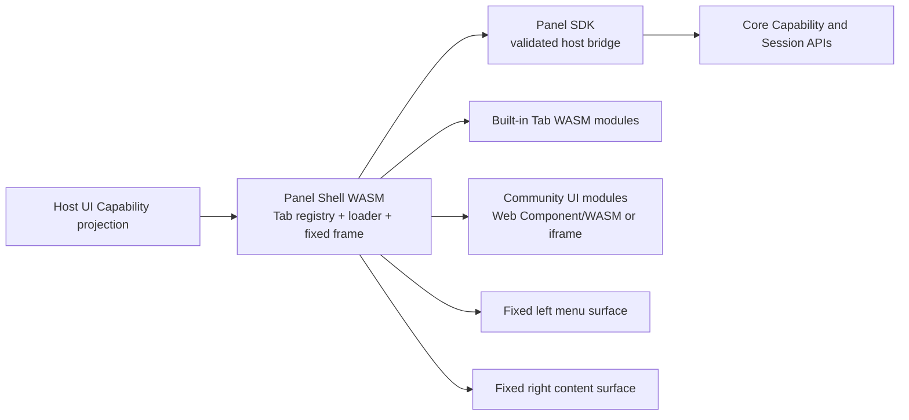

# Panel Tab UI Capability Design

**Date**: 2026-10-26  
**Status**: Approved — 2026-10-26 user approval received  
**Scope**: Modular Panel UI, dynamic built-in Tab WASM loading, and community UI plugin entry points

## Intent

Aleph should evolve from one large Panel WASM application into a lightweight Panel Shell with independently loadable UI capabilities. A Tab is the user-facing entry point for a capability. Installing a UI plugin adds a Tab entry; opening the entry mounts a Panel interface with a fixed left navigation surface and right content surface; disabling or uninstalling the plugin removes the entry and releases its UI resources.

This addresses two related problems:

1. The current `aleph-panel` WASM module statically includes all wide, phone, and tablet views. The built artifact is approximately 67 MB raw and 3.6 MB Brotli-compressed, so the browser initializes functionality that the user may never open.
2. Current plugin runtimes provide Core-side WASM/Extism, MCP, and static capabilities, but they do not provide a browser-side UI contract that can register a Tab and mount a Panel interface.

The intended result is capability-oriented composition: the host owns stable Panel infrastructure, while built-in and community features contribute independently registered UI modules.

## Goals

- Keep a small, always-loaded Panel Shell responsible for navigation, Tab registration, fixed layout, theme, identity, connection state, loading/error surfaces, and the Panel SDK.
- Compile selected built-in Tabs as independently loadable WASM modules and load them only when the user opens the corresponding Tab.
- Give each Tab a stable descriptor and lifecycle boundary for discovery, registration, mount, unmount, enable, disable, and replacement.
- Let a community plugin contribute a Tab entry and a left-menu/right-content Panel interface through an explicit UI Capability contract.
- Allow bundled Aleph Tabs to be disabled and unregistered without deleting their bundled assets; allow installed plugin Tabs to be uninstalled together with their registration and assets.
- Preserve Core capability ownership and lifecycle separately from browser UI mount state. Closing a UI Tab must not silently terminate a running Core provider or session.
- Measure real first-load bytes, WASM instantiation time, current-page memory, duplicate shared dependencies, and unload correctness before migrating every Tab.
- Keep implementation work isolated in a dedicated Git worktree, with the main worktree used for design, review, and integration only.

## Non-goals

- Replacing the existing Core plugin runtimes or treating browser UI WASM as an Extism plugin.
- Making every current view independently loadable in the first implementation slice.
- Designing a general-purpose browser sandbox for arbitrary untrusted JavaScript.
- Introducing Rust dynamic libraries or in-process hot unloading on the server.
- Moving business logic into the Panel interface layer. Core remains the owner of domain behavior and Capability authorization.
- Solving total installed-size reduction. Splitting may reduce initial download and active memory while duplicating common WASM dependencies across modules.
- Changing phone and tablet layouts in the first migration unless the shared contract proves that their surface requirements can be represented without weakening the wide Panel boundary.

## Anti-goals

The implementation must not claim that same-origin browser WASM is a security sandbox. A dynamically imported UI module runs in the browser's origin and needs an explicit trust and permission policy. A community UI module must not receive Core access merely because it declares a manifest entry.

The implementation must not create a second authoritative plugin registry inside the Panel. The existing extension discovery, plugin state, Capability registry, and lifecycle ownership remain authoritative; the Panel consumes a projection of UI descriptors and sends user actions through the existing host boundary.

The implementation must not make a hidden UI loader decide which Core provider to start, stop, or restart. UI lifecycle and provider lifecycle are separate state machines connected by explicit Capability operations.

## Current constraints and evidence

- `interfaces/webchat/index.html` has one Trunk Rust entry point.
- `interfaces/webchat/Cargo.toml` defines one `aleph-panel` WASM crate.
- `interfaces/webchat/src/lib.rs` uses `#[wasm_bindgen(start)]` to mount `app::App`.
- `interfaces/webchat/src/app.rs` statically imports the current views and provides long-lived application contexts at the root.
- Existing plugin WASM uses the Core-side Extism runtime and is not a browser UI module.
- The project constitution requires externally composable capabilities to use Capability contracts, keeps UI logic in Leptos/WASM, and requires root checks through `bun run check`.
- The concrete implementation must use an isolated worktree. The branch must follow the repository rule of at most three words separated by hyphens and must be based on `origin/dev` when that branch is available; the current repository state must be verified before creating it.

## Approaches considered

### A. Single WASM with delayed initialization

Keep one crate and initialize heavy features only after their first use. This is the lowest-risk transition and can reduce runtime work, but it does not reduce the initial WASM download or create an independent community UI boundary. It is suitable only as a temporary optimization or fallback.

### B. Panel Shell plus built-in Tab WASM modules

Split the host and selected Tabs into separate WASM entry points. A small browser loader downloads and mounts a Tab module when navigation activates it. The host and Tab communicate through a stable JavaScript/DOM Panel SDK boundary rather than sharing Leptos contexts or Rust types.

This is the selected base architecture because it directly addresses initial loading and gives built-in features the same lifecycle shape that community UI extensions need. It adds build orchestration, cross-module ABI design, and a risk of duplicated common dependencies; the spike must measure those costs.

### C. Shell plus Web Component or iframe community UI

Use the Shell and Tab registry from B, while community plugins provide a browser module through a Web Component-style mount contract or an iframe. Web Components provide a more native visual integration; iframes provide stronger isolation but add communication, sizing, theme, and navigation costs.

This is selected as the community integration direction, with the exact trust boundary decided by the plugin policy. Same-origin Web Components or WASM are appropriate only for trusted or verified extensions. An iframe remains the safer boundary for extensions that must not execute with host-origin privileges.

## Selected architecture



### Panel Shell responsibilities

The Shell owns the stable composition surface:

- Tab descriptor projection, ordering, visibility, enable/disable state, and active selection;
- dynamic module loading, mount/unmount, loading state, failure isolation, and retry;
- the fixed left menu and right content containers;
- theme, locale, viewport/form-factor selection, identity, and connection state;
- Panel SDK construction and validation;
- cleanup of subscriptions, DOM nodes, and loader handles at unmount;
- navigation to other registered Tabs without importing their implementation directly.

The Shell must not import every Tab's Rust component statically. A Tab entry point is discovered through a descriptor and loaded through the selected build output.

### Tab module responsibilities

A Tab module owns its feature UI and its local menu/content behavior. It exposes a versioned lifecycle boundary conceptually equivalent to:

```text
describe() -> TabDescriptor
mount(sidebar_root, content_root, panel_sdk) -> MountedTab
unmount() -> dispose report
```

The exact Rust/JavaScript ABI is deliberately left to the spike. The contract must support:

- module API version negotiation;
- descriptor validation before mount;
- one active mount at a time per Tab surface;
- idempotent cleanup;
- explicit subscription disposal;
- error reporting without taking down the Shell;
- no direct sharing of Leptos `Context`, `Signal`, or Rust-owned state across modules.

A module may retain feature state through Core or a host storage capability, but unmounting its UI must release DOM and event resources. A running session or Core provider continues only when its own lifecycle contract says it should.

### UI Capability descriptor

The first implementation should introduce a UI-specific descriptor projection rather than duplicating the existing plugin registry. The descriptor needs, at minimum:

- stable plugin and Tab identifiers;
- display label, icon reference, ordering, and visibility scope;
- entry module URL or bundled asset reference;
- UI API version;
- declared host capabilities and permission requirements;
- trust/integrity metadata;
- lifecycle status and diagnostic information.

The host may display a descriptor only after the existing extension and trust policy has accepted it. Installation, enablement, and removal remain host operations; the browser receives a projection and reports UI lifecycle outcomes back through the host boundary.

### Community plugin manifest direction

The existing Claude Code-compatible manifest remains the base format. A future Aleph extension can add a UI declaration under the Aleph-owned namespace, for example:

```toml
[aleph.ui]
entry = "panel/panel-ui.js"
api_version = "1"
integrity = "sha256-..."
trust = "verified"

[[aleph.ui.tabs]]
id = "memory-tools"
label = "Memory Tools"
icon = "database"
order = 40
```

The exact schema is a later contract task. It must not grant permission by declaration alone; the host resolves declared permissions against the existing plugin trust and Capability policy.

## Build and loading strategy

The current single Trunk entry cannot produce route-level WASM chunks by itself. The target build should produce:

- one Shell artifact;
- one artifact per migrated built-in Tab;
- an asset manifest that maps validated Tab descriptors to module URLs and integrity data;
- a small loader that dynamically imports or instantiates the selected module.

The technical spike compares two build arrangements without changing the UI contract:

1. multiple independent Trunk outputs with a shared asset manifest;
2. `wasm-bindgen` web-target outputs orchestrated by the repository's existing build tooling and loaded as ES modules.

The spike selects the arrangement that gives reliable dynamic loading, reproducible release output, useful source maps, and acceptable dependency duplication. It must not introduce a JavaScript application framework merely to obtain route splitting.

## Lifecycle semantics

- **Installed**: the plugin and its descriptor are present, but its UI module has not necessarily been loaded.
- **Enabled**: the descriptor is eligible for the Tab projection.
- **Registered**: the descriptor appears in the Shell's current Tab registry.
- **Mounted**: the module owns the current sidebar/content DOM surfaces.
- **Unmounted**: the module has released UI resources; its Core capabilities may remain active according to their own lifecycle.
- **Disabled**: the descriptor is removed from the current registry and cannot be loaded.
- **Uninstalled**: plugin assets, registration, and derived UI projection are removed through the existing extension lifecycle.

A bundled built-in Tab may move between enabled and disabled without deleting its compiled asset. A community plugin uninstall must dispose its UI registration and remove its installed asset set. A failed module load leaves the Shell usable and exposes a diagnostic entry with retry.

## Staged implementation plan

### Stage 0 — Contract and baseline

Write the UI Capability descriptor and lifecycle contract, document the Shell/Tab boundary, and capture baseline metrics for the current Panel: compressed download size, compile/instantiate time, first interactive time, and browser memory after startup.

### Stage 1 — Isolated dynamic loading spike

After the contract exists, create an isolated implementation worktree and migrate one representative built-in Tab, preferably Terminal or Memory. Verify that the Shell starts without the Tab module, clicking its Tab downloads and mounts it, leaving it disposes its UI resources, and a failed load does not break navigation. Record raw and compressed artifact sizes and duplicate dependency costs.

The spike is disposable until its results are incorporated into the design and implementation plan. Keeping its code as production code requires a new review of the resulting design boundary.

### Stage 2 — Shell and registry integration

Implement the host-side UI descriptor projection, Tab registry, fixed Panel frame, loader state machine, and Panel SDK bridge. Keep the existing monolith as a fallback for unmigrated Tabs during the transition.

### Stage 3 — Built-in Tab migration

Migrate built-in wide Tabs incrementally. Remove their static imports from the Shell only after the corresponding module has lifecycle coverage and a fallback or rollback path. Keep phone/tablet behavior unchanged until the contract supports their surface needs.

### Stage 4 — Community UI capability

Extend the manifest and extension lifecycle to register UI descriptors, apply trust and permission policy, install/uninstall assets, and project descriptors into the Panel. Add the chosen Web Component/WASM or iframe boundary for community modules.

### Stage 5 — Hardening and cleanup

Add lifecycle leak checks, stale descriptor handling, module version negotiation, integrity verification, update/rollback behavior, accessibility checks, narrow and wide viewport testing, and removal of obsolete static Tab wiring.

## Spike acceptance criteria

The spike is successful only if it demonstrates all of the following with measured evidence:

- Shell initial output does not contain the pilot Tab's implementation code;
- opening the pilot Tab performs a single observable module load and mounts both surfaces;
- leaving the Tab removes its DOM and subscriptions without late callback errors;
- returning to the Tab follows the documented cache/reload policy;
- a missing or invalid module leaves the Shell and other Tabs usable;
- the host rejects an incompatible API version before mount;
- Core state and UI mount state remain separate;
- initial compressed bytes, pilot compressed bytes, instantiate time, active memory, and duplicate dependency size are recorded;
- the chosen build arrangement is reproducible from a clean worktree.

## Validation and delivery constraints

- All implementation work occurs in a dedicated Git worktree with one writer. The main worktree is not used for concurrent implementation edits.
- The implementation branch is based on the repository's required base branch and follows the short branch naming rule.
- Run focused checks from the affected package directories, then run the repository canonical `bun run check` from the root.
- UI behavior must be tested at narrow and wide terminal/browser sizes where the fixed left/right structure is involved.
- Changes to public protocol or server HTTP APIs require the repository's client generation step; this design does not authorize such changes by itself.
- No implementation begins until this design is approved and converted into an implementation plan.

## Decisions left to the builder

- Whether the first pilot is Terminal or Memory, based on current dependency weight and cleanest mount boundary.
- Whether the loader uses multiple Trunk outputs or direct `wasm-bindgen` ES modules, subject to the spike measurements.
- The exact JS/DOM ABI shape and whether the first version uses a thin custom loader without a new frontend framework.
- The exact cache policy for revisiting a mounted Tab, provided it preserves cleanup and documented memory behavior.

## User decisions recorded

- Selected architecture: Panel Shell plus dynamically loaded built-in Tab WASM modules, with community UI modules connected through a Panel SDK boundary.
- Dynamic Tab WASM loading is a technical spike placed after the Shell and Tab contract is defined.
- Concrete implementation must use an isolated worktree.

## Builder-check resolutions

The independent builder check found several plan-shaping ambiguities. The following calls resolve the items that do not require a product decision:

- **Next implementation slice**: the design describes the full target architecture, but the first writing plan covers Stage 0 and Stage 1 only: the UI descriptor/lifecycle contract, baseline measurements, the Shell boundary, and one isolated dynamic-loading spike. Stages 2–5 remain the migration roadmap and are not silently included in the first implementation worktree.
- **UI descriptor authority**: `ExtensionManager`, persisted plugin state, and the existing Capability/extension lifecycle remain the only authority. The Panel receives a projection through the existing host bridge. If the current bridge cannot carry the projection and lifecycle diagnostics, the plan may add one explicit Protocol/Server contract and then run the required client generation step; it may not add a second Panel-owned registry.
- **Community trust boundary for v1**: verified or explicitly trusted same-origin Web Component/WASM modules are the first supported community UI form. An untrusted extension is not treated as safe merely because it is WASM; iframe isolation is a later trust-tier implementation and must not be implied by the first SDK.
- **Initial Panel SDK**: the first SDK is deliberately small: capability invocation through the host permission gate, event subscription with disposal, navigation to a registered Tab, theme/locale read access, scoped plugin storage, and lifecycle/error reporting. Identity and connection state are exposed only as validated read models, not as raw session or transport handles.
- **Migration fallback**: the old monolithic Panel is a build-time rollback artifact during the pilot, not a second runtime mounted beside the Shell. Unmigrated Tabs stay in the current application until they are migrated; the first spike does not attempt to make the Shell dynamically host both application models.
- **DOM ownership**: the Shell owns the outer frame and the two root elements. A Tab owns only descendants of the supplied sidebar and content roots; it cannot replace the frame, attach global listeners without a disposable handle, or rely on Shell-owned Leptos contexts.
- **Removal behavior**: disable or uninstall first invalidates the descriptor and cancels an in-flight load, then unmounts the active UI. If the removed Tab is current, the Shell navigates to the default built-in Tab. Core providers and sessions continue unless an explicit provider lifecycle operation is requested.
- **Registry identity and ordering**: the stable key is `(plugin_id, tab_id)`. Built-in entries use the reserved Aleph namespace; plugin entries cannot shadow them. Order ties resolve by stable fully-qualified key, and descriptor replacement is an explicit lifecycle transition rather than an implicit overwrite.
- **API compatibility**: the first contract uses a major API version. The Shell rejects an unsupported major before mount and reports the descriptor as incompatible; it does not silently downgrade a module.
- **Form-factor scope**: the first spike validates the wide Panel Shell and pilot Tab at narrow and wide viewport sizes. Phone and tablet remain on the current host path until the same descriptor can express their different navigation surfaces.

These calls keep the first plan bounded while preserving the selected long-term architecture.

## Spike results — 2026-10-26

The dynamic loading spike selected the direct `wasm-bindgen --target web` arrangement. It produced explicit `describe`/`mount` exports, a reproducible manifest entry, and a loader-compatible ES module layout. Trunk was not installed, so the multi-Trunk comparison remains unmeasured.

Measured output:

- Existing host Panel assets: 184,947,474 raw bytes and 5,196,753 per-file Brotli bytes at quality 11. This includes the current monolithic views and is not a future lightweight Shell measurement.
- Terminal pilot assets: 303,538 raw bytes and 88,539 Brotli bytes.
- Shared WASM function-body overlap proxy: 1,353 bytes across 180 shared dependency package names. This is a reproducible duplication proxy, not linker attribution or guaranteed removable bytes.
- Pilot load and initialization: 10 ms in Chromium; separate instantiate/start observation: 1 ms.
- Pilot linear-memory capacity observations: 1,179,648 bytes after mount and 1,114,112 bytes in the separate initialization run. These are capacity observations, not live allocations, JS heap, page RSS, or proof of memory reclamation.
- Browser artifact checks: initial pilot request count 0, first activation 1, re-entry 1; both roots rendered; idempotent unmount emptied both roots; missing entry rejected without owning either root; no page errors during cleanup observation.

The artifact Playwright command completed with 3 passed and 6 skipped. Full Shell/Gateway/WebSocket tests are explicitly gated by `PANEL_SPIKE_FULL_SHELL=1`; the disposable spike server has no Gateway or WebSocket proxy, so the spike does not claim live host SDK, transport, navigation fallback, or alternate-Tab E2E coverage. These results validate the independent artifact and lazy loading boundary, not a production `TerminalView` migration or total installed-size reduction. See the detailed report at `.superpowers/sdd/2026-10-26-panel-tab-ui-capability-spike-plan/task-6-report.md`.

## Open approval

This document is ready for review. Approval should confirm the goals, selected architecture, staged plan, and the stated trust boundary for community UI modules. After approval, the next step is to invoke the writing-plans workflow; implementation will then happen in a dedicated worktree.
