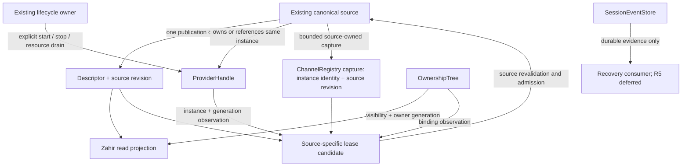
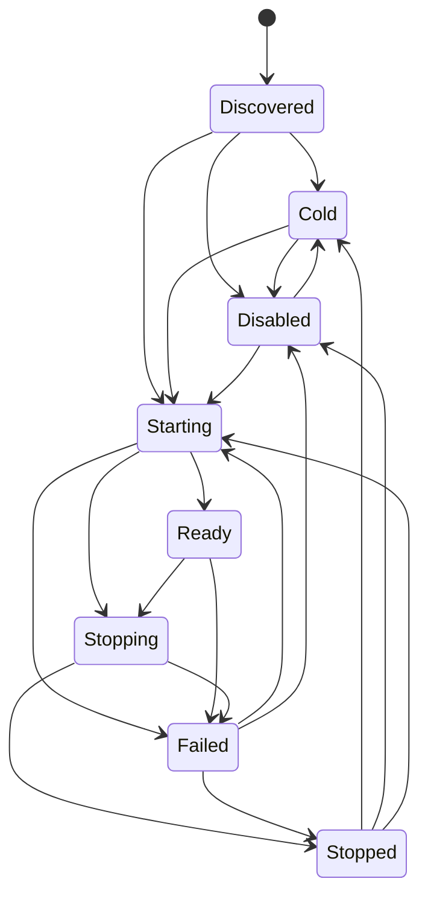

# R1 Provider / Source / Lease Design Gate

日期 / Date: 2026-10-26

**Decision: R1 NO-GO / deferred.** R0 已通过；本文件完成 R1 的设计评估，但不批准 R2 或生产实现。R0 passed; this document records the R1 assessment, not approval to enter R2 or implement a provider.

**First unclosed contract / 第一个未闭合契约：** `ChannelRegistry` 现已提供 bounded source-owned capture：同一 registry boundary 捕获 channel instance `Arc` identity 与 channel-source publication revision，use boundary 通过同一 registry 验证仍为当前实例。仍未闭合的是把该 capture 与实际 `ProviderHandle` instance/generation、descriptor identity/schema/revision 和 completion acceptance 组成同一份 provider proof。`CapabilityBackend::snapshot` 仍只有 descriptor vector 和 cursor，不能单独提供该证明。缺口不是“必须先实现 universal lease”；Tool-specific lease 应继续保留。

**First unclosed contract / 第一个未闭合契约:** `ChannelRegistry` now provides a bounded source-owned capture: one registry boundary captures the channel instance `Arc` identity and channel-source publication revision, and the use boundary revalidates the same current instance through that registry. Still open is binding that capture to the actual `ProviderHandle` instance/generation, descriptor identity/schema/revision, and completion acceptance as one provider proof. `CapabilityBackend::snapshot` still contains only a descriptor vector and cursor. Keeping the Tool lease source-specific remains intentional.

## 1. Scope and baseline / 范围与基线

- Baseline: local `main`, `fe6104244` (`feat(capability): establish provider contract slice`). No remote refresh or remote-state claim in this assessment.
- R0: `cargo fmt --all --check`, `git diff --check`, `cargo check -p alephcore --tests`, `cargo clippy -p alephcore --tests -- -D warnings` all exited 0. `cargo test -p alephcore --lib capability::`: **214 passed, 0 failed, 21,243 filtered out**, 14.73s.
- Test linking emitted `ld: __eh_frame section too large (max 16MB) to encode dwarf unwind offsets in compact unwind table, performance of exception handling might be affected`; the suite still exited 0.
- 本轮先完成 R0，并在 R1 的已授权最小 slice 中补齐 `ChannelRegistry` 的通用 replacement/unregister teardown 语义；未进入 R2 Feishu 九类审计 / A/B call graph。This pass covers R0 and the bounded R1 lifecycle slice; R2 and Feishu capability wiring remain outside scope.
- R1 是既有行为回归加 bounded capture contract：`ChannelRegistry` 现在在同一 lifecycle boundary 生成 source revision + instance identity capture，并在 use boundary 以当前 registry entry 的 `Arc::ptr_eq` fail-closed 验证；source-owned provider binding、completion acceptance 和资源 receipts 仍未闭合。R0 is regression verification; this R1 slice has RED→GREEN evidence, but it is not the full provider/source/lease gate.

## 2. Relationship model / 关系模型



图中的 non-Tool capture/lease 是候选，不是已挂载组件；没有 Core provider 表或第二 descriptor 表。The non-Tool capture/lease edges are candidates, not mounted components. No Core provider or descriptor table is introduced.

`CapabilityDescriptor` 当前不含 provider instance 字段（`src/capability/descriptor.rs:149`）。descriptor 到 provider 的关系必须由既有 source 的 canonical capture 保证，不能靠文本 `ProviderId`、descriptor metadata 或新 map 拼接。A descriptor does not currently carry provider instance authority; the source must provide that relation through its capture, not through a second lookup table.

当前 Tool 实例关系在 `CanonicalEntryLease` / producer Ready proof 内保留；`ProviderHandle::same_instance` 比较 `Arc` 身份，文本 id 相同不等于实例相同（`src/tools/registry.rs:153`, `src/tools/registry.rs:235`, `src/capability/provider.rs:255`）。未来 source 的实例身份必须能在原 authority 内验证，不能靠 generation 数字单独判断。

当前 Tool `to_descriptor` 为 `owner` / `lifetime` 填 Runtime 默认值（`src/capability/backend.rs:120`），不能把这些描述字段当作重新读取的 owner binding 证据。实际 visibility binding 与 owner generation 仍只认 `OwnershipTree`。Tool descriptor defaults are projection metadata, not a second binding authority.

`Scope` 是查询过滤值（`src/capability/facade.rs:19`），没有 `dispose()` 方法；本文件所说 scope disposal 指 `OwnershipTree::dispose(LifetimeScope)`。不要把查询 scope 变成新的资源 supervisor。

## 3. Authority non-duplication / 唯一权威表

| Authority | 唯一拥有 / Owns | Core 可携带的 observation / Allowed observation | 禁止复制 / Forbidden duplicate |
|---|---|---|---|
| `ChannelRegistry` | channel instances, factories, desired intent, explicit start/stop, webhook mounts, channel-source publication revision | bounded `ChannelCapture` with instance `Arc` identity; same registry validates use | channel/enable/disposer maps, provider generation mirror |
| `ProviderHandle` | lifecycle state, instance identity, provider generation, admission verdict | clone of same handle + captured generation | provider state mirror, generation allocator |
| `OwnershipTree` | visibility binding, owner/lifetime, owner generation, claims, revoke/dispose | binding key + captured owner generation | owner map, second tombstone/disposer table |
| `ToolHandlerRegistry` | Tool descriptor/handler, canonical publication, revision | `CanonicalEntryLease`, descriptor projection | callable/descriptor/handler registry |
| Future existing source owner | its own declarations, instance binding, source publication and source-specific capture | immutable cut/reference, validated by same owner | generic registry-of-registries or source registry |
| Provider runtime owner | resources, admitted work, cancellation, drain, completion acceptance | source-owned admission/drain result | Core in-flight/task/resource supervisor |
| `SessionEventStore` | durable session event records and ordering | durable record references, only when separately approved | projection history or live feed as recovery store |
| Zahir / `ProjectionHost` | derived delivery/projection state | source snapshot + owner observation | lifecycle, external effect or durable authority |

Source anchors / 源码锚点：`src/gateway/channel_registry.rs:187`, `src/capability/provider.rs:234`, `src/capability/ownership.rs:334`, `src/capability/ownership.rs:401`, `src/tools/registry.rs:1519`, `src/session/store.rs:56`, `src/capability/projection_host.rs:540`.

这是 R1 authority inventory，不是 R2 Feishu 源码复闸。`ChannelCapture` 仍是 `ChannelRegistry` 的 crate-private source proof，不是第二份 authority，也没有把 provider/owner generation 复制进 Gateway。This is an R1 inventory, not an R2 Feishu audit. The capture is a crate-private proof owned by `ChannelRegistry`; it does not mirror provider/owner generation or add another authority.

## 4. Read and lease candidates / 读侧与 lease 候选

### 4.1 Preserve the existing source trait / 保留现有 source trait

现有签名（`src/capability/backend.rs:26`）：

```rust
pub trait CapabilityBackend: Send + Sync {
    fn lookup(&self, id: &CapabilityId) -> Option<CapabilityDescriptor>;
    fn enumerate(&self, scope: &Scope) -> Vec<CapabilityDescriptor>;
    fn snapshot(&self, scope: &Scope) -> CapabilitySnapshot;
}
```

选择：继续把它作为唯一 read-side source trait。不增加 `CapabilitySource` registry。多字段投影只消费一次 `snapshot`；不要用 `enumerate` + 第二次 revision read 拼接同代视图。lookup/enumerate 不隐含可调用授权。

Selected: preserve this read-side trait. Multi-field projections consume one snapshot; a separate enumeration and revision read cannot establish a coherent publication. Neither lookup nor enumeration grants invocation authority.

`CapabilitySnapshot { capabilities, committed_cursor }`（`src/capability/facade.rs:52`）没有 source identity / provider reference。source revision 只在其 source 内有序，不能把多个 source 的裸 cursor 做 max、相加或伪装成全局 cursor。未来跨 source aggregation 需要独立设计；R1 不为它新增总表。

A zero-state inherent capture/reference surface on an existing source is a candidate. It must be specified against a real authority before adding even a zero-state trait extension. Trait absence alone is not a reason to create a registry.

### 4.2 Option A — source-specific lease, common invariants / 选定的设计方向

下列是**未实现的签名候选**；`ExistingSource`, `SourceLease`, `SourceOwnedCapture` 都是占位符，不是本轮新增 Rust 类型，也不是 Feishu adapter：

```text
ExistingSource::capture(&self, reference: &Reference)
    -> Result<SourceLease, ResolveError>
ExistingSource::validate(&self, lease: &SourceLease)
    -> Result<(), ResolveError>

SourceLease {
    descriptor: CapabilityDescriptor,
    owner_generation: OwnerGeneration,
    provider: ProviderHandle,
    provider_generation: u64,
    capture: SourceOwnedCapture,
}
```

- 原 source mint capture，固定 source identity、publication identity 与真实 provider instance；只复制 immutable observation，不复制 handler/state authority。
- descriptor 和 source capture 来自同一 publication；owner observation 单独从 `OwnershipTree` 读取，不能谎称与 publication 是跨权威原子事务。
- resolve 不启动 provider；只有 Ready/current instance 才发可执行 lease。
- use-time 由原 source 重新验证 capture/freshness、同一 provider instance/generation 和 tree binding；实际 admission 与 completion acceptance 仍由 provider/source owner 执行。
- source-wide revision 改变不一定使不相关 entry 失效；验证 entry/capture identity，不能把全局 source revision 当 owner/provider generation。
- 不改变 `BackendLease::canonical_entry`，不要求当前 `Zahir` trait 已能返回此候选。现有 `ZahirFacade` 只有 Tool adapter，非 Tool routing 是尚未批准的后续设计。

Selected direction: source-specific leases with shared validation invariants. This keeps capture and execution at their existing source, and preserves Tool compatibility. **Cost:** heterogeneous resolution and transport projection remain source-specific until a second real callable provider establishes a common shape; current `Zahir` cannot be declared universal merely from this sketch.

**Partially closed in A:** `ChannelRegistry::capture_channel` is now a concrete crate-private source-owned capture boundary. It records the registered channel `Arc` identity and source publication revision under the registry lifecycle boundary, and `validate_channel_capture` rejects replacement/unregister stale captures. The capture is deliberately not yet a universal provider lease: it is not bound to `ProviderHandle` instance/generation, descriptor identity/schema/revision, `OwnershipTree` owner generation, or admitted-work completion acceptance. Those remaining boundaries are the next R1 work; no new registry or test bypass may fill them. The placeholders are now grounded for channel source identity, but the full provider proof is still open.

### 4.3 Option B — universal erased validation envelope / 暂不选择

候选形状 / Candidate only:

```text
UniversalLease {
    descriptor: CapabilityDescriptor,
    owner_generation: OwnerGeneration,
    provider: ProviderHandle,
    provider_generation: u64,
    proof: opaque source-owned capture,
}
```

擦除 capture 类型后由 source-owned validator 解包；若再需要 `source_id -> validator/handler` 的 Core dispatch table，就重新制造 registry。一个闭集 enum 也会在每个新 source 上扩大 Core 依赖。opaque proof 的 `Eq`、transport serialization、ownership 和 completion validation 都缺真实第二 provider 约束。

An erased envelope could unify consumers, but risks a validator registry and hides capture invariants. A closed enum instead couples Core to each backend. Neither trade-off is justified before the second real callable provider. **Decision:** defer B; do not generalize Tool `canonical_entry` now. A future envelope must be observations plus source-owned proof, never a second invocation authority.

### 4.4 G1 closure requirements / 独立审查明确的阻断项

Independent read-only review supports NO-GO and identifies three missing design boundaries. These are accepted findings, not resolved interfaces. 下表细化首个未闭合契约；不以占位类型掩盖缺口，也不在本轮凭空补出 source authority。

| G1 boundary | Evidence required to close the design | Status |
|---|---|---|
| Source ownership and validation routing | Name the existing authority holding the source object, the caller retaining it, and the capture → use-validation call path without a source/validator dispatch registry | OPEN; `CapabilityBackend` currently supplies no such connection |
| Common channel replacement/unregister teardown | Existing `ChannelRegistry` must stop the incumbent before publication/removal for every channel type; a failed stop must retain the incumbent and its webhook mount | **CLOSED for this bounded lifecycle slice**; `ChannelRegistry::stop_outgoing_channel` + 3 real tests; does not prove provider capture or completion acceptance |
| Canonical capture and replacement | Specify who mints source instance identity, publication identity/revision and provider instance/generation; how each is compared; and the actual atomic capture/replacement boundary | **Partially closed for ChannelRegistry source identity**; `capture_channel` + `validate_channel_capture` provide the channel `Arc` identity and source revision boundary, with 3 focused tests. ProviderHandle/descriptor/owner/completion binding remains OPEN |
| Admission and completion acceptance | Define the source-owned observation/token retained by admitted work, the acceptance result, and the linearization boundary rejecting an old result after replacement/revoke/dispose | OPEN; ChannelCapture only validates current registered instance and does not admit work or accept completion |

必须在原 source 上给出具体所有者与边界，不能仅靠字段列表、闭包名字或 failure-matrix 的“必须”措辞宣称已闭合。The next R1 revision must ground these obligations in an existing source; no implementation or R2 authorization follows from this review.

**Current bounded result:** `ChannelRegistry` now applies its existing `stop_channel_inner` to every replacement and unregister path. The production boundary remains source-owned: the registry retains instance, desired-state, lifecycle, and webhook-mount authority; no capability registry or second owner map was added. RED→GREEN evidence covers non-Feishu stop, failed replacement retention, and failed unregister retention. This closes only the common channel teardown row above; it does not close G1's provider binding or admitted-work completion contract.

## 5. Lifecycle and disposal / 生命周期与释放

下图逐项对应 `src/capability/provider.rs:204` 的当前合法迁移；它不是新增 runtime orchestrator。



- 每次**进入 Starting**即 checked increment generation（`src/capability/provider.rs:186`），包括随后启动失败的尝试；不是“成功 Ready 时才递增”。Overflow leaves state unchanged and rejects start.
- `acquire_call` 要求 Ready 且 generation 相等（`src/capability/provider.rs:160`）。`ProviderHandle` 只持状态和 broadcast，不启动线程或网络；显式 start/stop 和资源清理由既有 lifecycle owner 负责。
- Discovered/Cold/Disabled：只能拥有轻量声明/契约对象，不得初始化 provider worker、connection、database、cache、token client、listener、websocket。普通 immutable snapshot 和 metadata allocation 不等于 provider runtime allocation。
- Ready 允许已启用 provider 的正常工作；启动资源初始化必须在显式 activation 边界内。Stopping 先拒绝新 admission，再由原 owner drain/cleanup。Failed 可能保留 cleanup residual，不能仅凭状态名声称资源全部释放。
- `Disposed` 不是 `ProviderState`。`OwnershipTree::dispose` 撤 binding、记 lifetime tombstone（`src/capability/ownership.rs:584`），自身不 stop provider、不 join task。不能以 owner disposal 冒充资源 disposal。
- 只有既有 owner 证明对该 provider 有独占生命周期责任时，scope disposal 才能经该 owner 请求 stop；shared Runtime provider 不能因某个 Session/Run binding 被撤而整实例停止。共享资源的最后使用者策略尚未设计，不引入 Core refcount/disposer map。

## 6. Failure matrix / replacement、revoke、dispose、late completion

“必须”列是后续 source 合约；证据列严格区分 Tool 证据和未证明的非 Tool 行为。Requirements below are not claims that a non-Tool implementation already exists.

| Trigger | Admission / validation requirement | Accepted work / completion requirement | Current evidence and limit |
|---|---|---|---|
| Discovered/Cold/Disabled | no executable lease, no implicit start/auth/network | no runtime work created by reads | cold Tool tests `src/capability/zahir_facade.rs:608`, `:618`, `:628`; no non-Tool resource receipts |
| Starting/Stopping/Stopped/Failed | reject new calls | lifecycle owner handles cleanup residual; no fake drained success | provider state test `src/capability/provider.rs:430`; not a resource/drain proof |
| Restart same handle | new Starting generation invalidates old lease | old generation cannot publish as successor | `src/capability/zahir_facade.rs:697`; completion test at `:740` is a local fence simulation |
| Replace instance, same textual id / same numeric generation | compare actual instance + source capture, not names/numbers | outgoing owner cannot withdraw or mutate replacement | `ProviderHandle::same_instance`, `src/capability/provider.rs:255`; non-Tool source binding remains G1 |
| Replace descriptor/handler | old entry capture/fingerprint/revision fails closed | never pair old handler with new descriptor | `src/capability/zahir_facade.rs:861`, `src/tools/registry.rs:235`; compatibility cached calls retain their existing rules |
| Unregister | source no longer resolves entry | source-specific accepted-work policy must be explicit | `src/tools/registry.rs:1415`; Tool ownership binding is not automatically revoked |
| Owner bump | old owner generation => `StaleOwner` | completion must recheck the applicable binding at its acceptance boundary | `src/capability/zahir_facade.rs:723`; no universal completion receipt contract |
| Revoke capability | remove bindings + irreversible id tombstone | reject subsequent use; no read-side resurrection | `src/capability/ownership.rs:534`, `:566`; does not itself cancel arbitrary work |
| Dispose lifetime | remove covered bindings + irreversible lifetime tombstone | owner-driven cleanup, shared providers not implicitly stopped | `src/capability/ownership.rs:584`; no provider-resource drain implied |
| Visibility mismatch | missing matching tree binding => hide/reject | guessed id cannot widen scope | `src/capability/zahir_facade.rs:823`; `Reference.visibility` selects binding |
| In-flight late result | source/provider revalidate instance/generation before accepting result | discard stale completion; cannot roll back an already executed external action | plugin `ProviderCallHandler` post-await check `src/tools/registry.rs:355`; not universal external-effect fencing |
| Counter exhaustion | checked failure; never saturate/reuse generation | no stale reference becomes valid again | `src/capability/provider.rs:452`, `src/capability/ownership.rs:697` |
| Lag / notification loss | resync from truthful current snapshot | no per-event or durable-replay claim | `src/capability/zahir_facade.rs:1132`; R4/R5 remain deferred |

Plugin post-await fencing applies to producer Ready proof; compatibility builtin/MCP captures retain documented cached-call semantics (`src/tools/registry.rs:149`). The 214-test capability suite does not execute every Tool registry test and cannot prove accepted webhook ownership or external exactly-once.

## 7. Read-side effect audit / no-start、no-auth、no-network 证明边界

| Surface | Current Tool call path | What the code establishes |
|---|---|---|
| describe | `ZahirFacade::describe` → ownership reconcile → `CapabilityBackend::snapshot` → `canonical_publication` → local descriptor projection + tree filter | local locks/snapshots only; no lifecycle transition, auth or network call |
| list | consumer list of the same describe snapshot; no separate Zahir `list` method | inherits that read path; not a new callable or authority |
| project | `ZahirFacade::project` → describe → ids | no handler invocation or activation |
| resolve | namespace check → registry `capture_entry` → `resolve_with_capture` → local provider/tree checks | no implicit start; not-Ready capture fails closed |

Anchors: `src/capability/zahir_facade.rs:389`, `src/capability/zahir_facade.rs:403`, `src/capability/zahir_facade.rs:350`, `src/capability/zahir_facade.rs:484`, `src/capability/backend.rs:72`, `src/tools/registry.rs:1385`, `src/tools/registry.rs:1519`.

Tool read paths allocate ordinary projection values and may `register_if_absent` an ownership binding (`src/capability/zahir_facade.rs:135`, `src/capability/ownership.rs:362`). 因此它们是 no-start/no-auth/no-network，不是“绝对无状态变更或零分配”。既有 Tool reconciliation 不授权未来 source 在 resolve 内注册 handler 或启动 provider。

Source inspection plus the existing cold Tool tests establishes the Tool path only. The tests assert empty projection and unchanged `(Cold, 0)`; they do **not** observe thread/socket/database/cache/token allocations. A non-Tool implementation might allocate resources without changing provider state, so that assertion cannot prove universal isolation. No Feishu read-side audit is claimed here.

## 8. Fixture proof contract / 待实现的资源证明

此节规定测试验收点，不创建 test-only production authority，也不声称 fixture 已存在。The fixture must exercise the actual source capture and provider admission boundary selected for implementation; a fake Core registry cannot stand in for it.

| Receipt at the actual allocation/effect boundary | Required assertion |
|---|---|
| Worker/thread/task starts and timer starts | zero delta across construction/discovery/describe/list/project/Cold resolve/Disabled reads |
| HTTP/token client and auth/token requests | zero constructions and zero requests on every read, including repeated and rejected reads |
| Listener bind, connection attempt, websocket open | zero attempts, including unsuccessful attempts |
| Database open and provider cache initialization | zero attempts on disabled/cold reads; metadata allocations excluded explicitly |
| Explicit activation and resource ownership | positive control: start increments the corresponding receipts; Ready only after source-owned publication succeeds |
| Stop/replacement and admitted work | deterministic barrier holds real admitted work; stop refuses new work, drain waits, release completes; old completion cannot affect successor |
| Binding revoke/dispose | binding fails independently of provider generation; resource-stop claims require owner cleanup evidence |
| Late completion and read-after-replacement/dispose | old capture rejected by production validation; reads still create no resources |

先写调用真实边界且会失败的测试并观察 RED，再实现最小 GREEN。资源计数必须在实际 constructor/admission/acceptance 处取证；不得只手动修改 counter 或用 `ProviderState` 不变替代证据。Use deterministic barriers, not sleep-based races. A local test fixture is not production authority and cannot authorize a mount.

**Current gap:** provider worker/token/database/listener receipts, source-owned capture, and completion acceptance remain open. The R1 slice now proves `ChannelRegistry` replacement/unregister teardown across a non-Feishu fixture: 2 focused replacement tests were RED before the generic helper and 3 focused lifecycle tests plus the full 41-test `gateway::channel_registry::tests::` filter are GREEN after it. This bounded fixture result is not a provider-resource proof.

## 9. Independent domains / 四域独立性

| Domain | Authority / mutation | Independence evidence / limit |
|---|---|---|
| Source revision / `CapabilityRevision` | source publication; Tool canonical registry cut | `src/tools/registry.rs:1519`; descriptor revision may remain unchanged when another entry changes; no global cross-source cursor |
| Provider generation | `ProviderLifecycle::transition(Starting)` | restart test changes provider generation while owner generation and source revision stay fixed: `src/capability/zahir_facade.rs:697` |
| Owner generation | `OwnershipTree::bump` and current binding observation | owner bump changes owner generation with source revision/provider generation fixed: `src/capability/zahir_facade.rs:723`, `src/capability/zahir_facade.rs:1264` |
| `SessionEvent.seq` / `EventSeq` | session append ordering supplied to and transactionally persisted by `SessionEventStore` | `src/session/events.rs:30`, `src/session/store.rs:56`, `src/session/store.rs:1235`; not read or allocated by the above provider/source/tree mutations |

Provider restart、owner bump、descriptor publication 的实现不 append SessionEvent；event store append 不驱动这些 authority。局部数值偶然相等没有跨域意义。`SessionEventStore` 持久化 session ordering；调用者提供 `first_seq`，不能声称 store 是全局 generation allocator。

`FacadeEntriesSnapshot` 明确只有两个各自一致的 cut，registry 与 tree 并非联合原子快照（`src/capability/zahir_facade.rs:45`）。未来 lease 可以携带四域 observation，但每域验证仍回到自己的 authority。

This is a source-boundary proof plus existing provider/owner tests, not a new four-domain runtime test. No session event was appended for this design pass; R5 decides durable effect/recovery semantics separately.

## 10. Gate ruling and unique next entry / 裁决与下一入口

| Gate item | Ruling |
|---|---|
| R0 Tool/Core baseline | PASS, 214 capability tests; baseline remains green |
| Keep nine kinds; Tool only Callable; no authority duplication | preserved |
| Keep `CapabilityBackend`; Tool lease remains source-specific | selected design direction |
| R1 common channel teardown slice | **PASS for bounded scope**: generic replacement/unregister stop fence; 3 focused tests; 41 ChannelRegistry tests |
| Non-Tool canonical source/provider capture and validation | **OPEN G1 — first unclosed provider contract** |
| Universal envelope | deferred until second real callable provider proves need |
| Cold/disabled zero provider-resource receipt proof | OPEN, §8; current tests are narrower |
| R1 overall | **NO-GO / deferred** |
| R2 Feishu A/B | not entered; no new GO/NO-GO conclusion supplied |
| R3–R7 | not entered |

**下一阶段唯一推荐入口：修订 R1 的 source-owned capture contract。** 在既有 authority 上明确 source instance identity、descriptor/provider 同代 capture、use/completion validation、replacement/unregister 的线性化边界和 resource receipts 取证点；提供具体签名与所有者，不新增 registry，不先写 Feishu adapter/facade/mount。该契约审查关闭后才能重新裁决 R1；此处不自动进入 R2。

**Unique next entry: revise the R1 source-owned capture contract**, grounding the candidate signatures and replacement/use/completion boundaries in an existing authority. Close that design question and the proof plan before reconsidering R1. This is not permission for Feishu implementation or a universal lease rewrite.

## 11. Deferred and not performed / 未做项

- 八类非 Tool backend 仍 deferred：Skill, Agent, Task, Resource, EventSource, Subscription, Plugin, Hook。既有 subsystem 的存在不等于已成为该 kind 的 Capability backend。
- Feishu、其他 Gateway channels、Terminal、Memory/graph、Sandbox 均未做 Capability migration。R2/R3 未执行；R4 event/subscription production semantics、R5 EffectClaim producer/Safe Replay/external exactly-once/durable recovery、R6/R7 未执行。
- 没有变更 public Rust API、Tool `BackendLease::canonical_entry`、provider/owner/source counters、durable store 或 Harness。新增的是 `ChannelRegistry` 私有 teardown 路径及真实行为测试；没有新增 authority。
- 未运行 full workspace check/test、真实 provider 资源 QA、Feishu/network tests 或新的 source-owned lease RED→GREEN；本轮只运行了 R1 teardown 专属测试和 `gateway::channel_registry::tests::` 过滤集。
- 未执行 commit、push、reset、rebase、stash、clean、merge、部署、消息发送、真实外部 provider start/stop 或远端配置变更。

Local evidence ledger: `.superpowers/sdd/2026-10-25-capability-core-remaining-roadmap/progress.md` (ignored runtime artifact, not a second durable application store).
