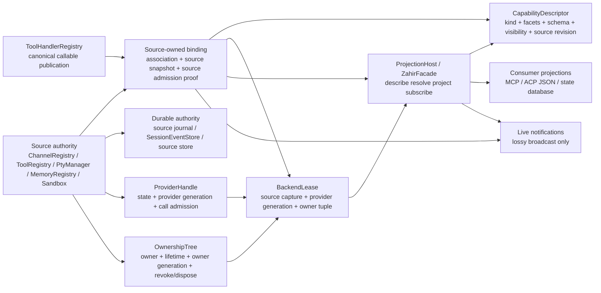

# Source-Owned Capability Contract Design
# Source-Owned Capability Contract 设计

- **Date / 日期:** 2026-10-30
- **Status / 状态:** Approved for planning after builder-check decisions / builder-check 决策后已批准进入 planning
- **Scope / 范围:** Capability Core contract only; no production mount or provider wiring / 仅 Capability Core 契约；不包含生产挂载或 provider wiring
- **Decision / 决策:** Adopt source-owned canonical binding plus derived Capability projection / 采用 source-owned canonical binding + derived Capability projection

## 1. Intent and why / 意图与原因

Aleph needs one verifiable contract for everything that can be dynamically discovered, called, replaced, subscribed to, or managed by an Agent, Runtime, or another system. The contract must support providers that are cold, disabled, started, stopped, or replaced without turning the Capability layer into a second runtime authority.

Aleph 需要为所有能够被 Agent、Runtime 或其他系统动态发现、调用、替换、订阅或管理的能力建立一个可验证的统一契约。该契约必须支持 cold、disabled、started、stopped 和 replaced provider，同时不能让 Capability 层变成第二个 runtime authority。

The design treats Capability as a source-backed semantic projection. Existing sources remain authoritative for association, intent, lifecycle, resource ownership, callable publication, and durable facts. Capability Core derives read surfaces, leases, projections, and live notifications from those authorities. It does not silently start a provider, refresh credentials, open a network connection, allocate a process, create a database, or publish a second handler table.

本设计将 Capability 视为 source-backed semantic projection。已有 source 继续分别拥有 association、intent、lifecycle、资源所有权、callable publication 和 durable facts。Capability Core 从这些 authority 派生 read surface、lease、projection 和 live notification；它不会隐式启动 provider、刷新凭证、打开网络连接、分配进程、创建数据库或发布第二份 handler 表。

## 2. Goals, non-goals, and anti-goals / 目标、非目标与反目标

### Goals / 目标

1. Define a universal source-owned binding contract that can be audited against Tool, Gateway, Feishu, Terminal, Memory, and Sandbox.
2. Preserve the existing authority of `ToolHandlerRegistry`, `ChannelRegistry`, `ProviderHandle`, `OwnershipTree`, `PtyManager`, `MemoryExtensionRegistry`, and sandbox runtime components.
3. Make identity, revision, lease, replacement, visibility, ownership, and durability boundaries explicit.
4. Prove that `describe`, `list`, `project`, `resolve`, and `subscribe` are read-side operations with no provider start, authentication, network, or resource initialization.
5. Define a bounded next implementation slice without authorizing Feishu production mounting.

1. 定义一个可对 Tool、Gateway、Feishu、Terminal、Memory 和 Sandbox 进行审计的通用 source-owned binding 契约。
2. 保留 `ToolHandlerRegistry`、`ChannelRegistry`、`ProviderHandle`、`OwnershipTree`、`PtyManager`、`MemoryExtensionRegistry` 和 sandbox runtime 组件的既有 authority。
3. 明确 identity、revision、lease、replacement、visibility、ownership 和 durability 的边界。
4. 证明 `describe`、`list`、`project`、`resolve` 和 `subscribe` 都是不会启动 provider、认证、网络或资源初始化的 read-side 操作。
5. 定义受限的下一步 implementation slice，但不授权 Feishu 生产挂载。

### Non-goals / 非目标

- Adding a `CapabilityKind`.
- Creating a second registry, owner map, descriptor catalog, handler map, enabled-state map, runtime table, or durable store.
- Replacing `ChannelRegistry` with Zahir or routing around it.
- Treating Feishu as the source of the universal Core shape.
- Implementing Feishu → Zahir wiring, Feishu production mount, EffectClaim producers, Safe Replay, external exactly-once, universal scheduling, native unload, process isolation, RSS reduction, or crash recovery.
- Modifying `src/harness/**`.
- Making live broadcast a durable recovery source.

- 不新增 `CapabilityKind`。
- 不创建第二个 registry、owner map、descriptor catalog、handler map、enabled-state map、runtime table 或 durable store。
- 不用 Zahir 替换 `ChannelRegistry`，也不绕过 `ChannelRegistry`。
- 不把 Feishu 特例作为通用 Core 形状来源。
- 不实现 Feishu → Zahir wiring、Feishu 生产挂载、EffectClaim producer、Safe Replay、external exactly-once、universal scheduler、native unload、process isolation、RSS reduction 或 crash recovery。
- 不修改 `src/harness/**`。
- 不把 live broadcast 当作 durable recovery source。

### Anti-goals / 反目标

The following outcomes would mean the design failed even if the code compiled:

即使代码可以编译，出现以下结果也表示设计失败：

- A disabled provider creates a thread, connection, token client, database, cache, listener, websocket, or child process.
- A projection can resolve or invoke a stale instance because one authority counter was reused for another fact.
- A new Capability catalog becomes the de facto lifecycle authority.
- A read surface requires authentication or network access to answer a descriptor query.
- A replacement reports success before the old instance is revoked and admitted work is drained or its residual is recorded.

- disabled provider 创建线程、连接、token client、数据库、缓存、listener、websocket 或子进程。
- 因为复用某个 authority counter，projection 解析或调用了 stale instance。
- 新 Capability catalog 事实上成为 lifecycle authority。
- read surface 必须认证或访问网络才能回答 descriptor query。
- replacement 在旧 instance 被 revoke 且 admitted work 被 drain 或 residual 被记录之前就报告成功。

## 3. Constraints and source evidence / 约束与 source evidence

The design follows the project redlines in `docs/reference/REDLINES.md`, especially R1, R3, R4, R6, and R8. `docs/reference/ARCHITECTURE.md` defines Capability as a semantic contract rather than another plugin or dependency-injection container. The current architecture record says Tool has the only live Capability backend, while channel, PTY, memory/MCP, and other kinds remain deferred.

本设计遵循 `docs/reference/REDLINES.md` 中的 R1、R3、R4、R6 和 R8。`docs/reference/ARCHITECTURE.md` 将 Capability 定义为 semantic contract，而不是新的 plugin 或 dependency-injection container。当前架构记录确认 Tool 是唯一已有 live Capability backend，channel、PTY、memory/MCP 及其他 kind 仍 deferred。

The source audit confirmed:

- `src/capability/descriptor.rs` already separates `CapabilityKind` from orthogonal `CapabilityFacet` and states that only `Tool` is executable today.
- `src/capability/provider.rs` defines side-effect-free `ProviderLifecycle` and `ProviderHandle`, including checked generation exhaustion and exact-generation call admission.
- `src/capability/facade.rs` defines `Zahir` as a query/read face and `BackendLease` as a stale-checkable value, never as a live handler.
- `src/capability/ownership.rs` owns owner/lifetime/generation/revoke/dispose and checks both owner identity and owner generation.
- `src/gateway/channel_registry.rs` owns channel association, desired intent, source revision, replacement, stop/drain, webhook publication, and bound-channel snapshots.
- `src/gateway/interfaces/feishu/**` has provider-local fencing and publication protection but also contains token refresh, HTTP, listener, task, and websocket startup; it is not yet a Capability mount.
- `src/gateway/pty/manager.rs` owns process-local PTY sessions, process creation, kill/removal, journaling, and a flush task.
- `src/memory/extensions/registry.rs` owns memory hook registration, MCP binding coherence, deduplication, unregister, and dispatch snapshots, but not provider generations or leases.
- Sandbox authority is distributed across `src/sandbox/factory.rs`, `src/sandbox/mod.rs`, `src/sandbox/summary.rs`, `src/sandbox/workspace.rs`, and related runtime/security modules; no unified Capability source contract exists there.

源码审计确认：

- `src/capability/descriptor.rs` 已将 `CapabilityKind` 与正交的 `CapabilityFacet` 分离，并明确当前只有 `Tool` 可执行。
- `src/capability/provider.rs` 定义了无副作用的 `ProviderLifecycle` 和 `ProviderHandle`，包括 checked generation exhaustion 与精确 generation 的 call admission。
- `src/capability/facade.rs` 将 `Zahir` 定义为 query/read face，将 `BackendLease` 定义为可检查 stale 的 value，而不是 live handler。
- `src/capability/ownership.rs` 拥有 owner/lifetime/generation/revoke/dispose，并同时验证 owner identity 与 owner generation。
- `src/gateway/channel_registry.rs` 拥有 channel association、desired intent、source revision、replacement、stop/drain、webhook publication 和 bound-channel snapshot。
- `src/gateway/interfaces/feishu/**` 已有 provider-local fencing 与 publication protection，但也包含 token refresh、HTTP、listener、task 和 websocket startup；它还不是 Capability mount。
- `src/gateway/pty/manager.rs` 拥有 process-local PTY session、进程创建、kill/removal、journal 和 flush task。
- `src/memory/extensions/registry.rs` 拥有 memory hook registration、MCP binding coherence、去重、unregister 和 dispatch snapshot，但不拥有 provider generation 或 lease。
- Sandbox authority 分散在 `src/sandbox/factory.rs`、`src/sandbox/mod.rs`、`src/sandbox/summary.rs`、`src/sandbox/workspace.rs` 及相关 runtime/security 模块，目前没有统一 Capability source contract。

## 4. Approaches considered / 已考虑方案

### A. Centralized Capability registry / 中心化 Capability registry

A new table would own descriptors, source associations, provider instances, enabled state, owner/lifetime, leases, revisions, and observers.

新的中心表统一拥有 descriptor、source association、provider instance、enabled state、owner/lifetime、lease、revision 和 observer。

**Benefits / 优点:** one apparent API; easy initial migration for sources without existing projection types; one place to enumerate capabilities.

**Risks / 风险:** duplicates `ChannelRegistry`, `ToolHandlerRegistry`, `ProviderHandle`, `OwnershipTree`, and source-local tables; creates cross-authority lock ordering; risks making projection state authoritative; makes read-side no-start proof depend on the new table’s completeness; conflicts with R1/R3/R4 and the explicit prohibition on a second registry/runtime table.

**Decision / 决策:** rejected. Its apparent uniformity is purchased by duplicating facts that already have owners, so it cannot satisfy authority non-duplication.

**决策:** 拒绝。它的表面统一性来自复制已有 authority，无法满足 authority non-duplication。

### B. Source-owned canonical binding + derived Capability projection / source-owned canonical binding + derived Capability projection

Each source owns its association, lifecycle, resources, and durable facts. A Capability binding is a source-local read contract that exposes a coherent snapshot and, where already supported, a lease/admission proof. `ProjectionHost` / `ZahirFacade` composes those source-owned facts into a derived query surface.

每个 source 拥有自己的 association、lifecycle、资源和 durable facts。Capability binding 是 source-local read contract，暴露 coherent snapshot，并在 source 已支持时暴露 lease/admission proof。`ProjectionHost` / `ZahirFacade` 将这些 source-owned facts 组合成 derived query surface。

**Benefits / 优点:** preserves existing authorities; permits source-specific lifecycle and cleanup; keeps real I/O outside pure source gates; makes each proof explicit; allows Tool and bounded Gateway evidence to coexist without implying Feishu or other sources are complete.

**Costs / 代价:** every source must specify its binding, snapshot, replacement, read-side boundary, and admission proof; a generic adapter cannot make an incomplete source compliant; cross-source projections need an explicit coherent-cut rule.

**Decision / 决策:** selected. It is the only approach consistent with the current source ownership and the no-second-authority redline.

**决策:** 采用。它是唯一同时符合当前 source ownership 与 no-second-authority redline 的方案。

## 5. Contract model / 契约模型

### 5.1 Relationship diagram / 关系图



The arrows are read/derivation relationships. Mutation remains at the existing source or authority. `ProjectionHost` and `ZahirFacade` may coordinate a coherent read but must not become the writer for source association, source intent, provider lifecycle, ownership, callable publication, or durable recovery.

箭头表示读取/派生关系。mutation 仍然发生在已有 source 或 authority 中。`ProjectionHost` 与 `ZahirFacade` 可以协调 coherent read，但不能成为 source association、source intent、provider lifecycle、ownership、callable publication 或 durable recovery 的 writer。

### 5.2 Authority non-duplication table / authority non-duplication 表

| Fact or state / 事实或状态 | Canonical owner / canonical owner | Capability layer may do / Capability 层可做 | Capability layer must not do / Capability 层禁止 |
|---|---|---|---|
| Source association and instance map / source association 与 instance map | Source registry, e.g. `ChannelRegistry` / source registry，例如 `ChannelRegistry` | Read a source snapshot and retain an opaque source capture / 读取 snapshot 并保留 opaque source capture | Create a parallel map or replace the source entry / 创建平行 map 或替换 source entry |
| Desired intent / desired intent | Source lifecycle owner, e.g. `ChannelRegistry::desired_state` / source lifecycle owner | Read declared intent / 读取 intent | Infer intent from descriptor state / 从 descriptor state 反推 intent |
| Provider state and provider generation / provider state 与 generation | `ProviderHandle` / `ProviderHandle` | Capture and validate exact generation / 捕获并验证精确 generation | Increment, reset, or reinterpret it as source/owner/revision / 增加、重置或改作其他 counter |
| Owner, lifetime, owner generation / owner、lifetime、owner generation | `OwnershipTree` / `OwnershipTree` | Read, validate, revoke through the existing contract where authorized / 读取并按既有契约验证 | Keep a second owner map or emulate revoke / 保持第二份 owner map 或模拟 revoke |
| Callable publication / callable publication | `ToolHandlerRegistry` / `ToolHandlerRegistry` | Resolve a canonical entry lease and project metadata / 解析 canonical entry lease 并投影 metadata | Store a second handler or invoke around registry admission / 保存第二份 handler 或绕过 admission 调用 |
| Capability descriptor / Capability descriptor | Derived from source binding plus schema/visibility facts / 从 source binding、schema、visibility 派生 | Build immutable descriptors and fingerprints / 构造 immutable descriptor 与 fingerprint | Treat descriptor catalog as lifecycle truth / 将 descriptor catalog 当作 lifecycle truth |
| Source revision / source revision | Source authority, e.g. `ChannelRegistry::source_revision` / source authority | Carry it as source publication evidence / 携带 publication evidence | Use it as provider or owner generation / 将其当作 provider 或 owner generation |
| Descriptor revision / descriptor revision | Source binding’s successful publication revision / source binding 的成功 publication revision | Identify the descriptor publication / 标识 descriptor publication | Claim it proves runtime readiness or durable delivery / 声称其证明 runtime ready 或 durable delivery |
| Effects and claims / effects 与 claims | Existing effect/source authority; `OwnershipTree` only for current claim fencing / 既有 effect/source authority；`OwnershipTree` 只负责当前 claim fencing | Describe facet only when producer proof exists / 仅在 producer proof 存在时描述 facet | Infer `ExternalEffect` or exactly-once from internal admission / 从 internal admission 推导 `ExternalEffect` 或 exactly-once |
| Durable recovery / durable recovery | Existing source journal/store or `SessionEventStore` as applicable / source journal/store 或适用的 `SessionEventStore` | Point to the durable authority / 指向 durable authority | Replay from live broadcast / 从 live broadcast replay |
| Live observer / live observer | Source/facade broadcast / source/facade broadcast | Notify and require resync on lag / 通知并在 lag 时要求 resync | Treat lag-free broadcast as durable truth / 将不丢事件的假设当作 durable truth |

### 5.3 Canonical identity / canonical identity

The contract uses a tuple whose components are intentionally non-interchangeable:

契约使用一个有意不可互换的 tuple：

```text
CapabilityIdentity = {
  capability_id,
  source_identity,
  source_entry_identity,
  provider_id,
  provider_generation,
  owner_ref,
  owner_generation,
  descriptor_revision,
  source_revision,
  visibility_scope,
  lifetime_scope,
}
```

- `capability_id` is the stable semantic lookup name, such as `aleph/gateway/channels/<id>`.
- `source_identity` identifies the authority instance, not merely a textual provider id.
- `source_entry_identity` fences replacement of an association entry; for Gateway this is the published `Arc` entry/capture identity.
- `provider_id` names the provider family/instance domain; `provider_generation` fences provider restart and stale call admission.
- `owner_ref` and `owner_generation` fence ownership transfer, bump, revoke, and dispose.
- `descriptor_revision` identifies a successful descriptor publication within the source binding.
- `source_revision` identifies the source publication sequence, such as Gateway channel publication revision.
- `visibility_scope` and `lifetime_scope` determine which binding is observable and how long its authority remains valid.
- `SessionEvent.seq` is a separate durable event sequence and does not participate as a substitute for any of the above.

- `capability_id` 是稳定的 semantic lookup name，例如 `aleph/gateway/channels/<id>`。
- `source_identity` 标识 authority instance，而不只是文本形式的 provider id。
- `source_entry_identity` fence association entry 的 replacement；Gateway 中对应已发布的 `Arc` entry/capture identity。
- `provider_id` 命名 provider family/instance domain；`provider_generation` fence provider restart 与 stale call admission。
- `owner_ref` 与 `owner_generation` fence ownership transfer、bump、revoke 和 dispose。
- `descriptor_revision` 标识 source binding 内成功的 descriptor publication。
- `source_revision` 标识 source publication sequence，例如 Gateway channel publication revision。
- `visibility_scope` 与 `lifetime_scope` 决定哪些 binding 可见以及 authority 保持多久。
- `SessionEvent.seq` 是独立的 durable event sequence，不能替代上述任何 counter。

A lease is valid only when the source capture, provider state/generation, owner identity/generation/lifetime, visibility, and canonical callable entry all validate at the use boundary. Any missing or unclassifiable proof fails closed.

lease 只有在 use boundary 同时验证 source capture、provider state/generation、owner identity/generation/lifetime、visibility 和 canonical callable entry 后才有效。任何缺失或无法分类的 proof 都必须 fail closed。

## 6. Lifecycle contract / lifecycle 契约

### 6.1 States / 状态

The universal descriptive state vocabulary is:

通用 descriptive state vocabulary 为：

`Discovered → Cold → Disabled → Starting → Ready → Stopping → Stopped`, with `Failed` reachable from `Starting`, `Ready`, or `Stopping` according to the source contract. `ProviderState` already defines these values. A source may expose a subset, but it must map omitted states explicitly rather than silently collapsing them.

`Discovered → Cold → Disabled → Starting → Ready → Stopping → Stopped`，并允许根据 source contract 从 `Starting`、`Ready` 或 `Stopping` 进入 `Failed`。`ProviderState` 已定义这些值。source 可以只支持其中一部分，但必须显式映射省略状态，不能静默合并。

| State / 状态 | Read / 读取 | Call / 调用 | Replace / 替换 | Revoke / revoke | Dispose / dispose |
|---|---|---|---|---|---|
| Discovered / 已发现 | Declaration-only / 仅声明 | Refuse / 拒绝 | Allowed by source / source 允许 | Allowed if source owns binding / source 拥有 binding 时允许 | Source-defined / source 定义 |
| Cold / 冷态 | Yes, no-start / 可以，无启动 | Refuse / 拒绝 | Allowed / 允许 | Allowed / 允许 | Allowed / 允许 |
| Disabled / 禁用 | Yes, no-start / 可以，无启动 | Refuse / 拒绝 | Allowed / 允许 | Allowed / 允许 | Allowed / 允许 |
| Starting / 启动中 | Snapshot only; no new admission / 仅 snapshot，不新增 admission | Refuse unless source explicitly proves a separate admitted path / 除非 source 明确证明独立 admitted path，否则拒绝 | Must fence current start / 必须 fence 当前启动 | Allowed / 允许 | Wait or record residual / 等待或记录 residual |
| Ready / 就绪 | Yes / 可以 | Allowed after exact lease/admission validation / 精确 lease/admission 验证后允许 | Replacement protocol required / 必须 replacement protocol | Allowed; drains admitted work / 允许并 drain admitted work | Allowed; residual required on uncertain cleanup / 允许，不确定 cleanup 必须 residual |
| Stopping / 停止中 | Snapshot may remain visible but not executable / snapshot 可见但不可执行 | Refuse new calls / 拒绝新调用 | New publication waits for source fence / 新 publication 等 source fence | Idempotent / 幂等 | Continue drain / 继续 drain |
| Stopped / 已停止 | Declaration may remain if source chooses / source 可保留 declaration | Refuse / 拒绝 | New generation only / 只能新 generation | Idempotent / 幂等 | Idempotent / 幂等 |
| Failed / 失败 | Expose failure without starting / 暴露失败且不启动 | Refuse / 拒绝 | New start/replacement only through source / 只能经 source 新启动/replacement | Allowed / 允许 | Source-defined / source 定义 |

Read-side descriptors may report a cold or disabled declaration. They must not imply that a declaration is callable, authenticated, connected, or durable.

read-side descriptor 可以报告 cold 或 disabled declaration，但不能暗示其 callable、已认证、已连接或 durable。

### 6.2 Replacement protocol / replacement protocol

The source-owned replacement sequence is:

source-owned replacement 顺序为：

1. **Preflight / 预检:** source validates replacement policy and checked revision/generation availability before destructive mutation. Exhaustion fails closed.
2. **Quiesce / 静默:** source stops new admissions for the outgoing instance.
3. **Revoke / 撤销:** source/provider/ownership authority invalidates the outgoing lease according to its own contract.
4. **Drain / 排空:** source drains admitted work. If cleanup cannot prove completion, it records a residual and does not claim complete disposal.
5. **Publish / 发布:** source publishes the new entry/instance and its descriptor snapshot under the source’s canonical mutation boundary.
6. **Activate / 激活:** only an explicit source lifecycle driver may perform network, authentication, thread, process, listener, websocket, or other side effects. `ProviderHandle` records the state transition and generation; it does not perform those effects.
7. **Late completion rule / late completion:** old completions validate source entry identity, provider generation, and any owner tuple before mutating source state. A stale completion is rejected or ignored with a typed failure; it cannot withdraw or overwrite the replacement.
8. **Observer rule / observer:** live notifications report the committed source change. A lagging observer resyncs from the source snapshot or durable source authority.

The sequence is intentionally source-specific. A generic projection cannot claim that a source has drained, joined, closed, or recovered unless the source supplies that evidence.

该顺序有意保留 source-specific。generic projection 不能在 source 没有提供证据时声称已 drain、join、close 或 recover。

## 7. No-start, no-auth, no-network proofs / no-start、no-auth、no-network 证明

For each source binding, the implementation plan must require a cold-read proof with these properties:

每个 source binding 的 implementation plan 必须要求 cold-read proof，满足以下性质：

- `describe`, `list`, `project`, and `subscribe` read immutable declarations, source snapshots, or local live notification cursors only.
- `resolve` may construct a value lease, but must not call a token getter, HTTP client, listener bind, websocket connect, process spawn, database open, cache hydration that reaches an external source, or extension execution.
- `subscribe` attaches to an existing notification source only. It cannot create a provider, register a handler, or advance lifecycle state.
- `ProviderLifecycle::new`, `ProviderLifecycle::ready`, and `ProviderHandle::snapshot` remain pure state operations. `ProviderHandle` state publication is not evidence that runtime effects happened.
- For Feishu, `auth.get_token`, `TokenManager::refresh_token`, `TcpListener::bind`, `tokio::spawn`, and `tokio_tungstenite::connect_async` belong strictly after explicit source activation.
- For Terminal, `PtyManager::start_flush_loop`, `PtySession::spawn`, and process journal child creation belong strictly after explicit terminal activation or user action.
- For Sandbox, `build_sandbox` and `WorkspaceSandbox::new` are runtime assembly paths; a summary read may consume an existing `SandboxSummary` but must not assemble or execute a sandbox.
- For Memory, a descriptor read may inspect the registry snapshot but must not dispatch extension hooks or refresh an external MCP binding.

- `describe`、`list`、`project` 和 `subscribe` 只能读取 immutable declaration、source snapshot 或已有 live notification cursor。
- `resolve` 可以构造 value lease，但不能调用 token getter、HTTP client、listener bind、websocket connect、process spawn、database open、会触及外部 source 的 cache hydration 或 extension execution。
- `subscribe` 只能连接已有 notification source，不能创建 provider、注册 handler 或推进 lifecycle state。
- `ProviderLifecycle::new`、`ProviderLifecycle::ready` 和 `ProviderHandle::snapshot` 保持纯 state operation。`ProviderHandle` 的 state publication 不证明 runtime effects 已发生。
- 对 Feishu，`auth.get_token`、`TokenManager::refresh_token`、`TcpListener::bind`、`tokio::spawn` 和 `tokio_tungstenite::connect_async` 必须严格位于显式 source activation 之后。
- 对 Terminal，`PtyManager::start_flush_loop`、`PtySession::spawn` 和 process journal child creation 必须严格位于显式 terminal activation 或用户操作之后。
- 对 Sandbox，`build_sandbox` 与 `WorkspaceSandbox::new` 属于 runtime assembly path；summary read 可以消费已有 `SandboxSummary`，但不能组装或执行 sandbox。
- 对 Memory，descriptor read 可以查看 registry snapshot，但不能 dispatch extension hook 或刷新外部 MCP binding。

## 7.1 Operation contract / 操作契约

The five read/query operations have deliberately narrow meanings:

五个 read/query operation 的含义有意保持狭窄：

| Operation / 操作 | Contract / 契约 | Forbidden implication / 禁止推断 |
|---|---|---|
| `describe(scope)` / `describe(scope)` | Return an immutable coherent descriptor snapshot under the requested visibility/scope. / 返回请求 visibility/scope 下 immutable coherent descriptor snapshot。 | Does not start, authenticate, or prove callable readiness. / 不启动、不认证，也不证明 callable ready。 |
| `list(scope)` / `list(scope)` | A transport-facing alias over the same source-backed descriptor snapshot, optionally filtered by kind/facet/namespace. It is not a second storage surface. / 面向 transport 的 alias，读取同一个 source-backed descriptor snapshot，可按 kind/facet/namespace 过滤；不是第二存储面。 | Must not enumerate a separate catalog or infer lifecycle from absence. / 不得枚举独立 catalog，也不得从缺失反推 lifecycle。 |
| `project(target, scope)` / `project(target, scope)` | Project visible capability IDs and metadata to MCP, ACP JSON, or state database using the same snapshot cut. / 使用同一 snapshot cut 将可见 capability ID 与 metadata 投影到 MCP、ACP JSON 或 state database。 | Projection is derived and cannot publish handlers or change source state. / projection 是 derived 的，不能发布 handler 或修改 source state。 |
| `resolve(reference)` / `resolve(reference)` | Validate visibility and current binding presence, then mint a value `BackendLease` with captured source/provider/owner evidence. / 验证 visibility 与当前 binding 存在后，构造带 source/provider/owner evidence 的 value `BackendLease`。 | It does not call the provider or refresh credentials. / 不调用 provider，也不刷新凭证。 |
| `subscribe(scope, cursor)` / `subscribe(scope, cursor)` | Attach to an existing live notification source and anchor it to a coherent snapshot cursor; lag requires resync from source snapshot/durable authority. / 连接已有 live notification source，并以 coherent snapshot cursor 为锚；lag 时从 source snapshot/durable authority resync。 | It is not replay, durable recovery, or lifecycle activation. / 它不是 replay、durable recovery 或 lifecycle activation。 |

`CapabilityBackend` remains the source adapter boundary for a backend that can produce descriptors and canonical entry evidence. `ProjectionHost` / `ZahirFacade` consumes that boundary and the existing owner/provider authorities; it is not a new backend registry.

`CapabilityBackend` 仍是 backend 生成 descriptor 与 canonical entry evidence 的 source adapter boundary。`ProjectionHost` / `ZahirFacade` 消费该 boundary 以及已有 owner/provider authority；它不是新的 backend registry。

## 8. Visibility, scope, lease, and effect claims / visibility、scope、lease 与 effect claim

`VisibilityScope` determines whether a binding is visible to a caller. `LifetimeScope` determines the authority lifetime. `OwnerRef` identifies the owner. `OwnerGeneration` invalidates an authorization fact after `OwnershipTree::bump`, revoke, or dispose. The captured owner identity is also required because owner transfer may occur without advancing the tree epoch.

`VisibilityScope` 决定 caller 是否能看到 binding。`LifetimeScope` 决定 authority lifetime。`OwnerRef` 标识 owner。`OwnerGeneration` 在 `OwnershipTree::bump`、revoke 或 dispose 后使 authorization fact 失效。由于 owner transfer 可能不推进 tree epoch，captured owner identity 同样是必需的。

A `BackendLease` is a proof that a caller may attempt a source operation. It is not proof that the external effect happened. `ProviderLifecycle::acquire_call` proves current state and provider generation at admission. It does not prove network delivery, message acceptance, process completion, or exactly-once execution.

`BackendLease` 是 caller 可以尝试 source operation 的 proof，不是外部 effect 已发生的 proof。`ProviderLifecycle::acquire_call` 证明 admission 时 state 与 provider generation 正确；它不证明网络 delivery、消息接受、进程完成或 exactly-once execution。

`CapabilityFacet::ProviderLifecycle` may be described only when the source exposes lifecycle state and replacement/lease evidence. `CapabilityFacet::ExternalEffect` may be described only after a separate effect producer defines claim, commit, residual, and recovery semantics. Internal admission fences must not be promoted to either facet by implication. The current phase therefore keeps EffectClaim producer integration deferred.

只有当 source 暴露 lifecycle state 与 replacement/lease evidence 时，才能描述 `CapabilityFacet::ProviderLifecycle`。只有在独立 effect producer 定义 claim、commit、residual 和 recovery semantics 后，才能描述 `CapabilityFacet::ExternalEffect`。internal admission fence 不能被隐式提升为任一 facet。因此当前阶段继续 defer EffectClaim producer integration。

## 9. Revision independence proof / revision 独立性证明

| Counter / counter | What it proves / 证明内容 | What it cannot prove / 不能证明 |
|---|---|---|
| Source revision / source revision | Successful publication/unpublication order in one source authority / 一个 source authority 内成功 publication/unpublication 顺序 | Provider readiness, owner authorization, durable delivery / provider ready、owner authorization、durable delivery |
| Provider generation / provider generation | A provider instance restart boundary and call admission / provider instance restart boundary 与 call admission | Source association identity, owner transfer, effect success / source association identity、owner transfer、effect success |
| Owner generation / owner generation | Ownership epoch invalidation for a lifetime scope / 某 lifetime scope 的 ownership epoch invalidation | Provider restart, descriptor change, durable sequence / provider restart、descriptor change、durable sequence |
| Descriptor revision / descriptor revision | Descriptor publication version/fingerprint within the source binding / source binding 内 descriptor publication version/fingerprint | Runtime start, call admission, external effect / runtime start、call admission、external effect |
| `SessionEvent.seq` / `SessionEvent.seq` | Durable event order in its event store / event store 内 durable event order | Source replacement, provider readiness, owner authority / source replacement、provider ready、owner authority |

The contract forbids arithmetic or equality assumptions across these counters. A coherent snapshot may carry several values together, but their meanings remain separate.

契约禁止在这些 counter 之间做 arithmetic 或 equality 假设。coherent snapshot 可以同时携带多个值，但它们的含义仍然独立。

## 10. Conformance audit / conformance audit

| Source / source | Existing authority / 现有 authority | Existing evidence / 已有 evidence | Missing contract / 缺失契约 | Classification / 分类 |
|---|---|---|---|---|
| Tool | `ToolHandlerRegistry`, `ToolBackendAdapter`, `ProviderHandle`, `OwnershipTree` | Canonical callable publication, provider generation admission, descriptor snapshot, `BackendLease`, source/facade validation, live-only broadcast | Production mount is still absent; effect producer is absent | Current conformance evidence; mount deferred / 当前 conformance evidence；mount deferred |
| Generic Gateway / loopback | `ChannelRegistry` map/entry, desired intent, source revision, lifecycle sync, webhook mount table | `register_bound_channel`, bound descriptor/provider creation, source-local capture, stop/drain and old-entry validation; checked publication exhaustion | Production Bound ingress/mount and all-channel compatibility proof | Bounded contract evidence; next minimal slice candidate / bounded evidence；可作为下一最小 slice |
| Feishu | `ChannelRegistry` owns channel association; `FeishuChannel` owns source runtime; local `ProviderHandle` and `api_handle` publish cache | Old generation cannot publish/withdraw replacement; cache lookup validates provider/generation; cleanup records residuals | Capability descriptor adapter, source binding to Zahir, resolve route, subscription/recovery producer, no-start read boundary proof | Audit only; B8.2 A/B/C/D NO-GO/deferred / 仅审计；B8.2 A/B/C/D NO-GO/deferred |
| Terminal | Process-global `PtyManager`, PTY session map, owner retention, process journal, event bus/flush loop | Source-local spawn/close/remove, owner checks, durable process facts, explicit flush loop | Descriptor/facets, provider generation, source capture, owner lease, replacement/late completion proof for capability use | Later source contract; no migration in this phase / 后续 source contract；本阶段不迁移 |
| Memory | `MemoryExtensionRegistry`, extension vector, MCP typed side-table, register/unregister, dispatch snapshots | Name dedup, coherent MCP registration/removal, lock dropped before async dispatch, fail-safe hook handling | Provider lifecycle, generation, descriptor, source revision, lease, replacement and durable observer contract | Later source contract; no migration in this phase / 后续 source contract；本阶段不迁移 |
| Sandbox | `build_sandbox`, `WorkspaceSandbox`, `NoopSandbox`, OS driver/security/policy modules, `SandboxSummary` | Disabled factory returns `NoopSandbox`; summary is value data; execution is explicit through `Sandbox::execute` | Single source authority, descriptor/facets, provider lifecycle, lease/replacement, no-assembly read proof across platform drivers | Later source contract; targeted audit required / 后续 source contract；需要定向审计 |

### Source-specific notes / source-specific 说明

- **Tool / Tool：** This is the strongest current conformance slice. The descriptor, canonical callable registry, provider generation, owner validation, and facade projection are source-backed. It still does not authorize generic kind backends or production Zahir mount.
- **Gateway / Gateway：** `ChannelRegistry` remains the only writer for `WebhookMountTable`; bound publication creates a cold lifecycle declaration and a source-local provider handle, while real stop/close/join I/O remains outside the publication gate. The bounded evidence is useful for the contract but is not all-channel or Feishu proof.
- **Feishu / Feishu：** `FeishuChannel::start_runtime` performs token refresh, bot lookup, token refresh task, listener bind or websocket start. `api_handle` is a derived cache with provider/generation fencing, not a Capability descriptor catalog. No Feishu route may be added from this design alone.
- **Terminal / Terminal：** `PtyManager::spawn` writes journal intent, creates a child, registers the session, and may evict/kill an old session; `start_flush_loop` calls `tokio::spawn`. A capability read must remain above these effects.
- **Memory / Memory：** `MemoryExtensionRegistry` is already careful about lock snapshots and unregister, but it is a dispatch registry rather than a provider runtime contract. A future binding must avoid treating dispatch success as external effect success.
- **Sandbox / Sandbox：** `NoopSandbox` is a useful disabled boundary, but the factory still assembles runtime policy objects when enabled. A future binding must define whether the capability is the sandbox posture, execution service, managed child seam, or separate capabilities; this design does not choose that kind.

## 11. Gate decision / Gate 决策

### R4 result: GO with a bounded implementation scope / R4 结果：GO，但实施范围必须受限

The source-owned contract is stable enough to enter an independent implementation plan for one minimal source-owned vertical slice. The evidence is sufficient because Tool provides a live end-to-end projection/lease example and Generic Gateway bound registration provides a source-local declaration, provider state, source revision, capture, and cleanup boundary. The plan must target the Generic Gateway binding contract or another explicitly approved minimal source; it must not target Feishu production mounting by default.

source-owned contract 已足够稳定，可以为一个最小 source-owned vertical slice 进入独立 implementation plan。证据足够的原因是：Tool 提供 live end-to-end projection/lease 示例，Generic Gateway bound registration 提供 source-local declaration、provider state、source revision、capture 和 cleanup boundary。plan 必须针对 Generic Gateway binding contract 或另一个明确批准的最小 source；默认不能针对 Feishu 生产挂载。

This GO is a design-gate result, not implementation authorization. Before any production Rust, test, CapabilityKind, Gateway wiring, or provider mount change:

这个 GO 是 design-gate 结论，不是 implementation authorization。在任何 production Rust、test、CapabilityKind、Gateway wiring 或 provider mount 修改之前，必须：

1. Obtain explicit approval of this design document.
2. Write and review a separate implementation plan for the selected minimal slice.
3. Reconfirm that the plan introduces no second authority and preserves source-owned lifecycle.
4. Run the project’s required checks only after implementation begins.

1. 获得本设计文档的明确批准。
2. 为选定的最小 slice 编写并审阅独立 implementation plan。
3. 再次确认 plan 不引入第二 authority 且保留 source-owned lifecycle。
4. 只有 implementation 开始后才运行项目要求的 checks。

The following remain NO-GO / deferred: Feishu → Zahir route, Feishu production mount, universal Gateway compatibility, Terminal/Memory/Sandbox backend migration, EffectClaim producer integration, Safe Replay, external exactly-once, durable capability scheduler, native unload, engine reclamation, OS mapping reclamation, RSS reduction, and process isolation.

以下继续 NO-GO / deferred：Feishu → Zahir route、Feishu 生产挂载、universal Gateway compatibility、Terminal/Memory/Sandbox backend migration、EffectClaim producer integration、Safe Replay、external exactly-once、durable capability scheduler、native unload、engine reclamation、OS mapping reclamation、RSS reduction 和 process isolation。

## 12. Validation and explicit non-actions / 验证与明确不做事项

### Validation performed / 已执行验证

- Read-only source and reference audit of the paths listed in the request.
- Compared the selected source-owned approach with the centralized registry alternative.
- Confirmed current repository HEAD before documentation changes: `48503ffc61adc47e8a8caf28a336f386f312619b`.
- Confirmed the current Tool, ProviderHandle, OwnershipTree, ChannelRegistry, Feishu, PTY, Memory, and Sandbox boundaries from source.

- 对请求列出的 source 与 reference path 完成只读审计。
- 比较了选中的 source-owned approach 与中心化 registry alternative。
- 在文档修改前确认当前 repository HEAD 为 `48503ffc61adc47e8a8caf28a336f386f312619b`。
- 从源码确认当前 Tool、ProviderHandle、OwnershipTree、ChannelRegistry、Feishu、PTY、Memory 和 Sandbox 边界。

### Not run / 未运行

- No Cargo check, test, clippy, fmt, build, live TUI, browser, network, or integration check was run for this design-only phase.
- No production Rust or test source was changed.
- No `CapabilityKind` was added or changed.
- No Gateway wiring, Feishu mount, Zahir route, EffectClaim producer, Safe Replay, scheduler, or provider runtime was implemented.
- No external message, push, merge, deployment, destructive action, or credential operation was performed.

- 本设计阶段未运行 Cargo check、test、clippy、fmt、build、live TUI、browser、network 或 integration check。
- 未修改 production Rust 或 test source。
- 未新增或修改 `CapabilityKind`。
- 未实现 Gateway wiring、Feishu mount、Zahir route、EffectClaim producer、Safe Replay、scheduler 或 provider runtime。
- 未执行外部消息、push、merge、deployment、destructive action 或 credential operation。

### Unclosed kinds and providers / 未关闭的 kind 与 provider

`CapabilityKind::Skill`, `Agent`, `Task`, `Resource`, `EventSource`, `Subscription`, `Plugin`, and `Hook` remain named but non-executable. Only `Tool` has a live backend. Gateway channel, Feishu, Terminal, Memory/MCP, Sandbox, and other provider slices remain source-specific and are not claimed as unified Capability backends.

`CapabilityKind::Skill`、`Agent`、`Task`、`Resource`、`EventSource`、`Subscription`、`Plugin` 和 `Hook` 仍只是命名且不可执行。只有 `Tool` 有 live backend。Gateway channel、Feishu、Terminal、Memory/MCP、Sandbox 及其他 provider slice 仍是 source-specific，不能声称已成为统一 Capability backend。

## 14. Resolved builder-check decisions / 已解决的 builder-check 决策

The builder-check identified four questions whose answers would materially change the first implementation plan. They are resolved as follows:

builder-check 识别出四个会实质改变首个 implementation plan 的问题，现明确如下：

1. **First slice boundary / 首个 slice 边界:** implement Generic Gateway `describe`, `list`, `project`, and `resolve`/lease evidence. Do not implement Gateway `subscribe`, observer wiring, or durable recovery in the first slice.
2. **Coherent snapshot / coherent snapshot:** anchor the read at the `ChannelRegistry` source cut, then validate provider and owner evidence. If source revision or entry identity changes, retry only within a bounded source-defined read rule or fail closed; do not create a cross-authority transaction.
3. **Gateway ownership / Gateway ownership:** use `OwnerRef::Runtime` and `LifetimeScope::Runtime` for the process-owned Gateway binding. `VisibilityScope` remains supplied by `ChannelLifecycleContract` and is not inferred by the projection.
4. **Revision independence / revision 独立性:** keep `source_revision` and `descriptor_revision` as separate source-owned facts. A successful publication may produce both facts from one event, but the values are not interchangeable; failed publication advances neither.

These decisions close the builder-check questions without authorizing Feishu production mounting or any other deferred provider migration.

这些决定关闭了 builder-check 问题，但没有授权 Feishu 生产挂载或任何其他 deferred provider migration。

## 15. Approval boundary / approval 边界

The design is now approved for a separate implementation plan covering only the bounded Generic Gateway read/lease slice above. The implementation plan must remain subordinate to this document and must not widen its scope. Production changes still require the plan to be reviewed before implementation begins.

本设计现已批准进入独立 implementation plan，但 plan 只能覆盖上述受限的 Generic Gateway read/lease slice。implementation plan 必须从属于本文档，不能扩大范围。生产变更仍须先审阅 plan，之后才能开始 implementation。
